# Chapter 2: Base and joint 1

**14:125:444 Smart Prosthetics and Robotic Systems** — Dr. Adam Gormley

[Assembly guide](assembly-guide.md) · [← Chapter 1: Planetary gearbox](assembly-1-gearbox.md) · [Chapter 3: Hinge and joint 2 →](assembly-3-hinge-joint2.md)

---

The base is a box that holds the J1 motor, with the hinge turning on top of it. J1 is the
waist: it turns the whole arm about a vertical axis. The motor's 20-tooth pulley drives a
160-tooth pulley through a belt, for **8:1**.

The hinge's shaft carries the load. A long stack sits on it: hinge, upper thrust bearing,
box top, lower thrust bearing and pulley, all clamped together by four M5 screws. The stack
turns in the box top's 6807 bearing, with a 608 bearing in the box bottom holding the
pulley's lower end.

Build this chapter **before putting the gearbox on**. The hinge is easier to handle
without it, and the gearbox would block some of the box's screws.

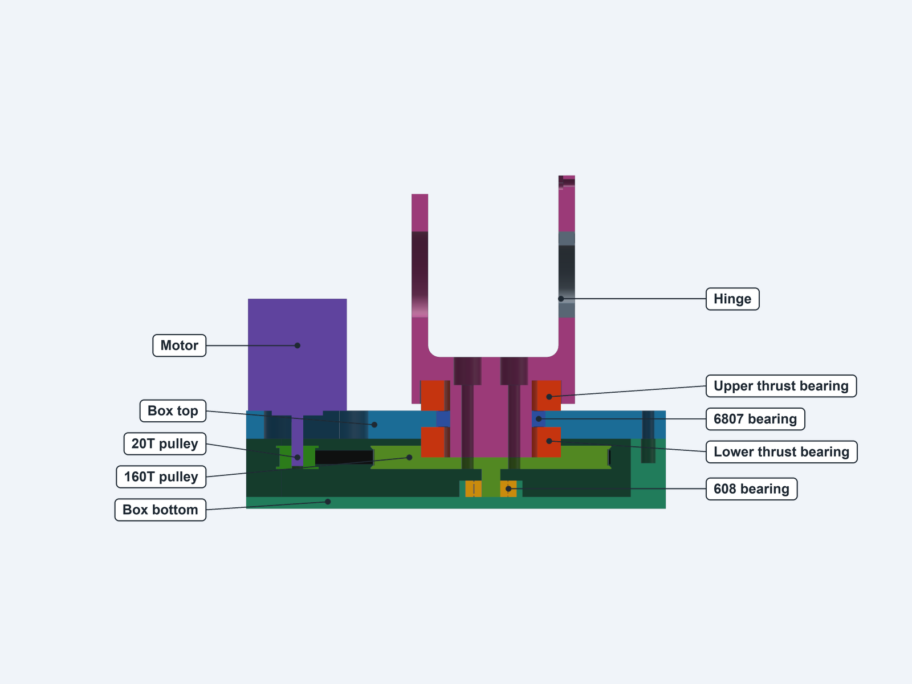

## Parts

**Printed**

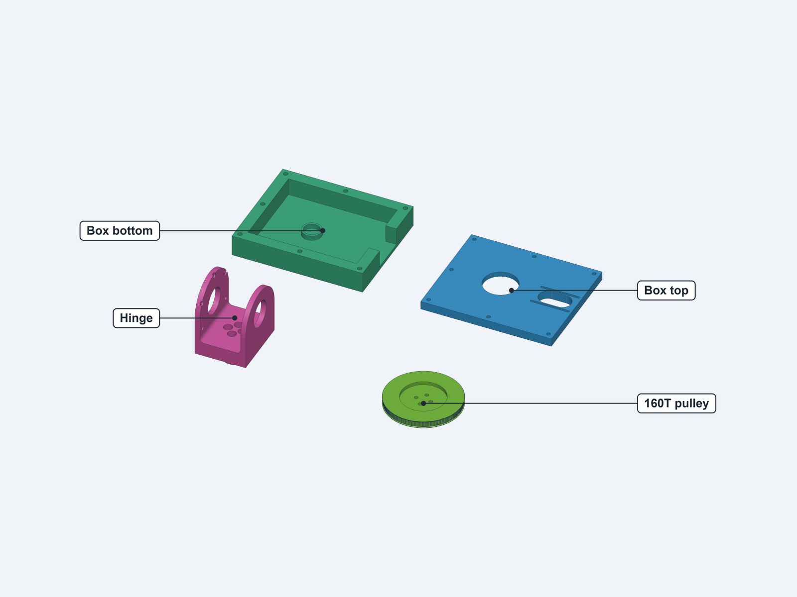

| Part | Print-list name | Qty |
|---|---|---|
| Box bottom | `box_bottom` | 1 |
| Box top | `box_top` | 1 |
| Hinge | `hinge` | 1 |
| 160T pulley | `gt2_pulley_160t` | 1 |

**Bought**

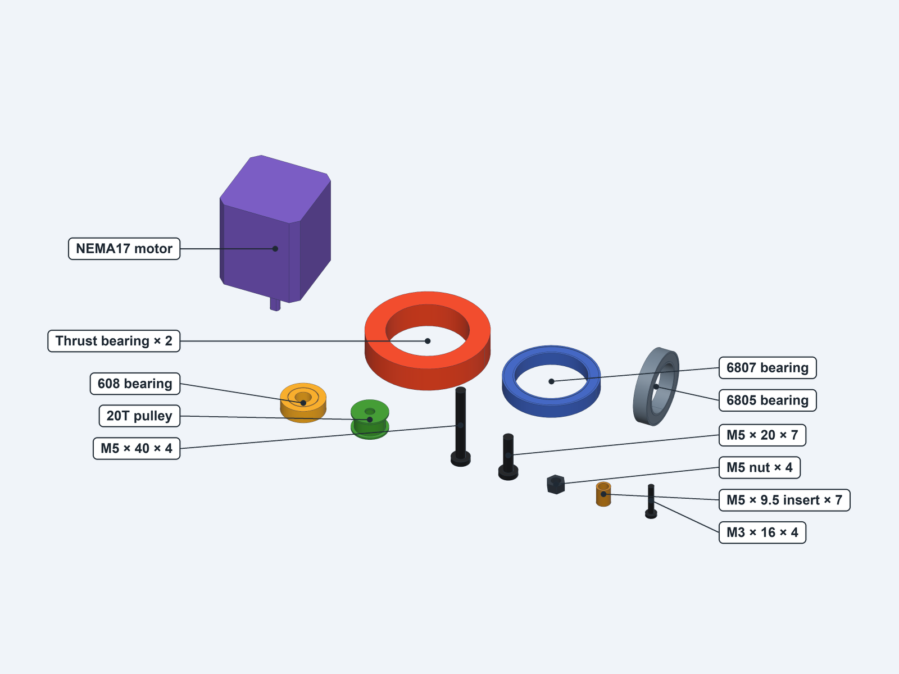

| Part | Qty | Where it goes |
|---|---|---|
| 51108 thrust bearing, 40 × 60 × 13 | 2 | Above and below the box top |
| 6807 bearing, 35 × 47 × 7 | 1 | Box top |
| 608 bearing, 8 × 22 × 7 | 1 | Box bottom |
| 6805 bearing, 25 × 37 × 7 | 1 | Hinge, gearbox cheek. The other cheek's is in Chapter 3 |
| NEMA17 motor, 48 mm body | 1 | J1 |
| GT2 20T pulley, 5 mm bore | 1 | J1 motor |
| GT2 closed belt, 6 mm wide, **370 mm** | 1 | **Not stocked yet:** on the to-order list in `inventory.md` §1 |
| Ruthex M5 × 9.5 insert | 7 | Box bottom |
| M5 × 40 button head screw | 4 | Hinge to pulley. Use this length: M5 × 45 would hit the 608 |
| M5 nut | 4 | Under the pulley |
| M5 × 20 button head screw (**TO CONFIRM**) | 7 | Box top to box bottom. Check the assortment has this length |
| M3 × 16 button head screw | 4 | Motor to box top |

## Step 16: Check the parts

1. Lay out every part and tick it off against the tables above.
2. Remove any support marks from fit surfaces and sand them lightly, as in step 0.
3. Try each fit dry, without forcing anything: the hinge shaft started in the 6807, the
   6807 and 608 started in their seats, and a thrust bearing in the box top's recess, the
   pulley's pocket and the hinge's pocket.
4. Try the **pulley's hub in the 608**. The hub is modelled at Ø8.0 exactly, with no
   allowance for printing. If it won't start, sand it gently until it does (**TO CONFIRM**).

**Check:** the thrust bearings drop into all three pockets, and the hub starts in the 608.

## Step 17: Install the threaded inserts in the box bottom

**Parts:** box bottom, 7 M5 × 9.5 inserts.

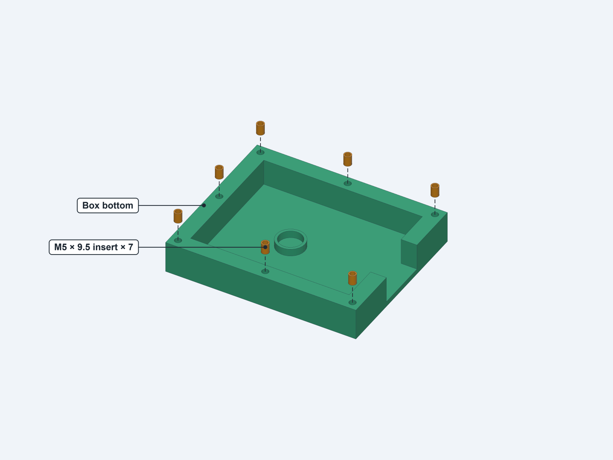

Install them as in [step 1](assembly-1-gearbox.md#step-1-install-the-threaded-inserts): heat-set in PLA, or
bonded with epoxy in resin, which needs 4–6 hours to set. **Plan ahead.**

**Check:** every insert is flush and square, and an M5 screw threads in by hand.

## Step 18: Press the 608 and 6807 bearings

**Parts:** box bottom, 608 bearing, box top, 6807 bearing.

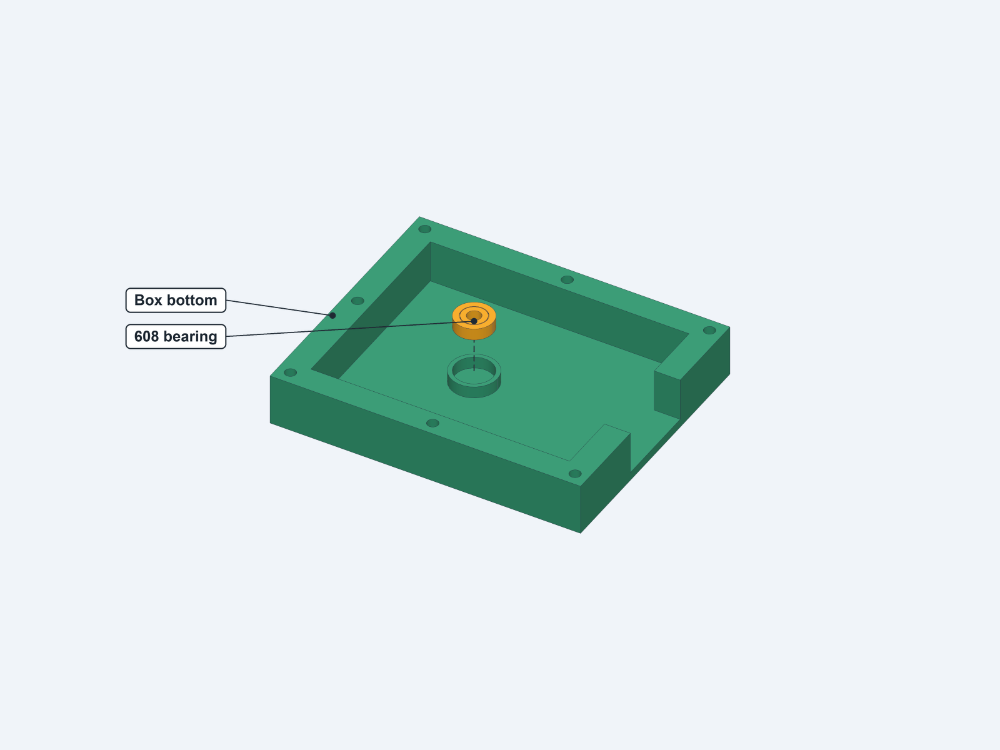

1. **Press the 608** into the raised ring on the box bottom's floor, until it reaches the
   floor.

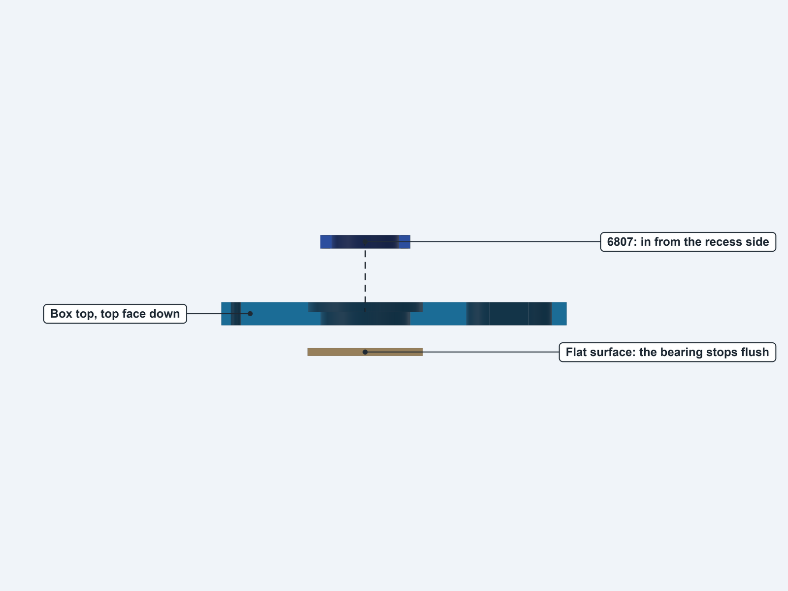

2. **Press the 6807** into the box top. Its seat goes all the way through and has **no
   shoulder to stop it**, so the bearing can go too far. Lay the box top with its **top
   face down on a flat surface**, so that the wide Ø60 recess faces up. Press the bearing in
   from the recess side until it stops on the flat surface.

**Check:** the 6807 is flush with the box top's top face, and both bearings spin freely.

## Step 19: Press a 6805 bearing into the hinge's gearbox cheek

**Parts:** hinge, 6805 bearing.

Do this now, while the hinge is on its own and fits in a vise. The hinge has two different
cheeks: the **taller** one takes the gearbox, and the bearing goes in that one.

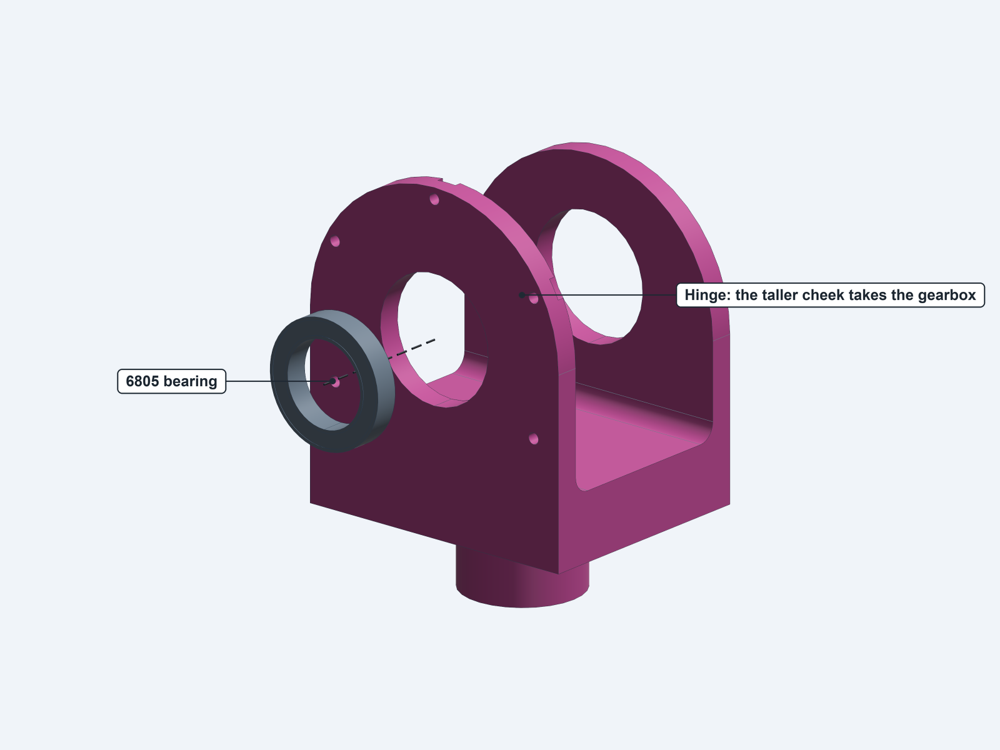

1. Put a block about 56 mm long between the cheeks, so that the vise doesn't bend them.
2. Start the bearing from the outside of the taller cheek. Put a flat plate over it.
3. Close the vise until the plate reaches the cheek. This seat has no shoulder either: the
   plate is what stops the bearing, flush with the cheek's outer face.

Leave the other cheek's seat **empty**. Chapter 3 needs it open.

**Check:** the bearing is flush with both faces of the cheek and spins freely.

## Step 20: Stack the joint 1 parts

**Parts:** 160T pulley, 2 thrust bearings, box top with its 6807, hinge.

The stack goes together from the bottom up. Each thrust bearing is **three loose pieces**,
two washers and a ball cage, so keep each set together. Grease them lightly with the gear
grease (**TO CONFIRM**).

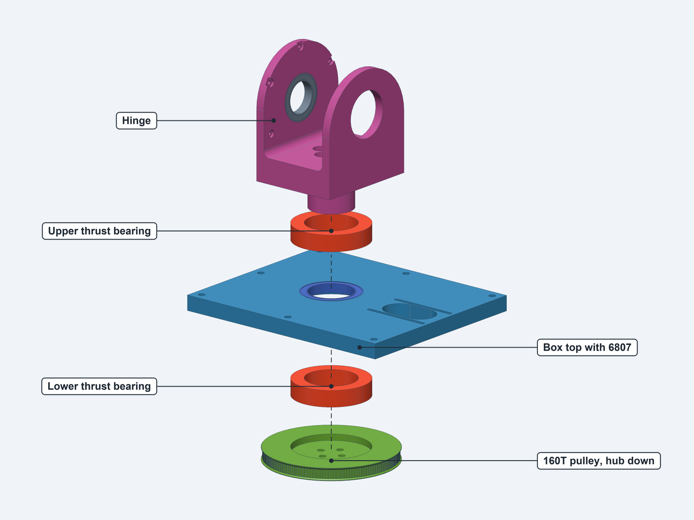

1. Stand the **pulley** on something that leaves room for its hub, such as a roll of tape.
   The hub points down.
2. Put the **lower thrust bearing** in the pulley's pocket.
3. Lower the **box top** onto it, top face up, so that the bearing enters the Ø60 recess.
4. Put the **upper thrust bearing** on the box top, around the 6807.
5. Lower the **hinge** so that its shaft passes through the upper thrust bearing and starts
   in the 6807. The bearing enters the pocket under the hinge's floor.
6. Press the hinge down, with a block on its floor if it needs a vise, until the shaft end
   stops on the floor of the pulley's pocket.
7. Turn the pulley until its 4 holes line up with the 4 holes in the hinge's floor.

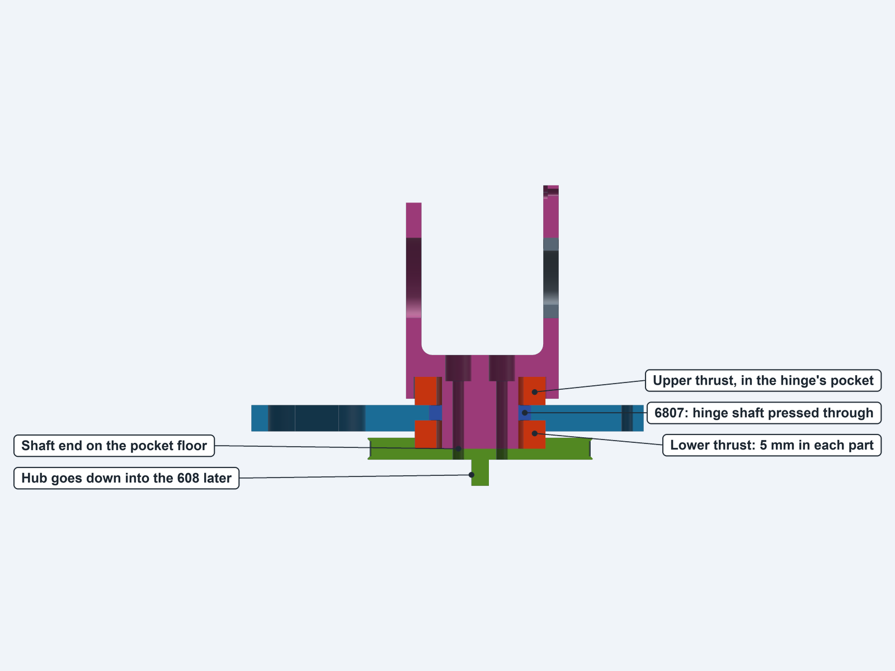

> **TO CONFIRM:** the two thrust bearings and the box top total 33 mm, and the shaft is also
> exactly 33 mm long. If the printed parts come out thick, the stack could bind when
> clamped in the next step. **Don't sand the shaft's end:** a shorter shaft makes it
> tighter. Ease the nuts off until it turns freely, and report what you found.

## Step 21: Clamp the stack with the M5 screws

**Parts:** stack, 4 M5 × 40 screws, 4 M5 nuts.

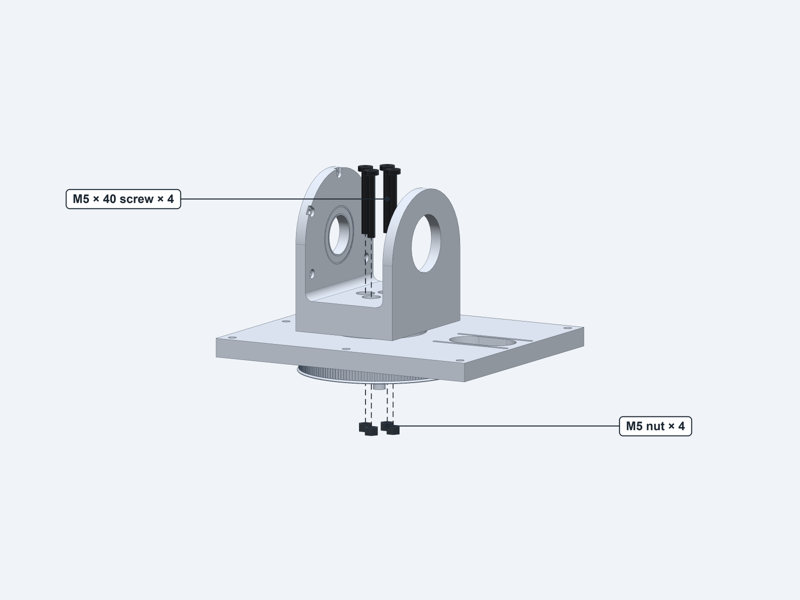

1. Drop the 4 screws through the hinge's floor. Their heads sit in the Ø12 counterbores.
2. Lift the assembly and thread a nut onto each screw under the pulley.
3. Hold each nut with the 8 mm spanner and tighten with the 3 mm hex key, evenly, a little
   at a time. Stop at snug: the shaft end bottoms on the pulley, so more force only
   stresses the plastic.

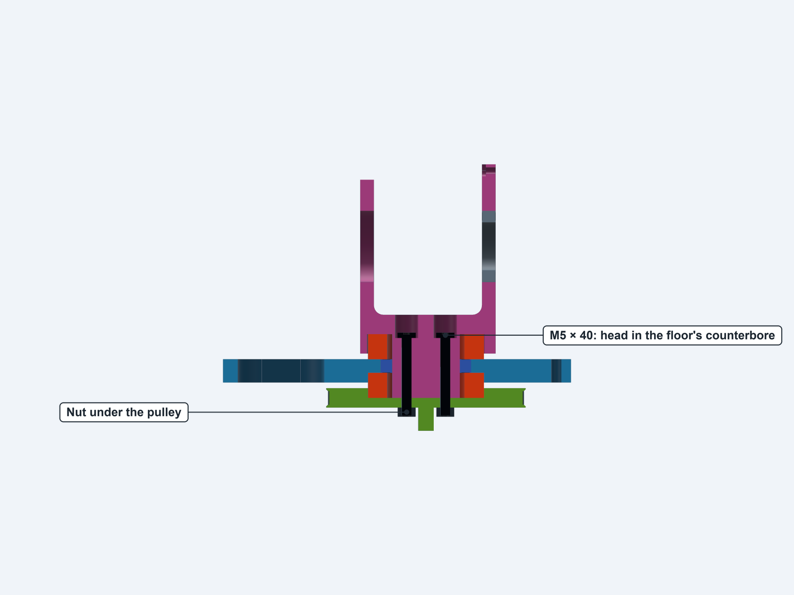

Don't use longer screws. With M5 × 40, the nut's far side is about 0.3 mm above the 608's
seat and the screw ends inside the nut. M5 × 45 would run into the 608 when the box closes.

**Check:** holding the box top, the hinge and pulley turn together, smoothly, with no tight
spot and no up-and-down play. If it binds, see the note in step 20.

## Step 22: Fit the 20T pulley to the J1 motor

**Parts:** NEMA17 motor, 20T pulley.

Do this now, because the pulley's set screw is hard to reach once the motor is on the box.

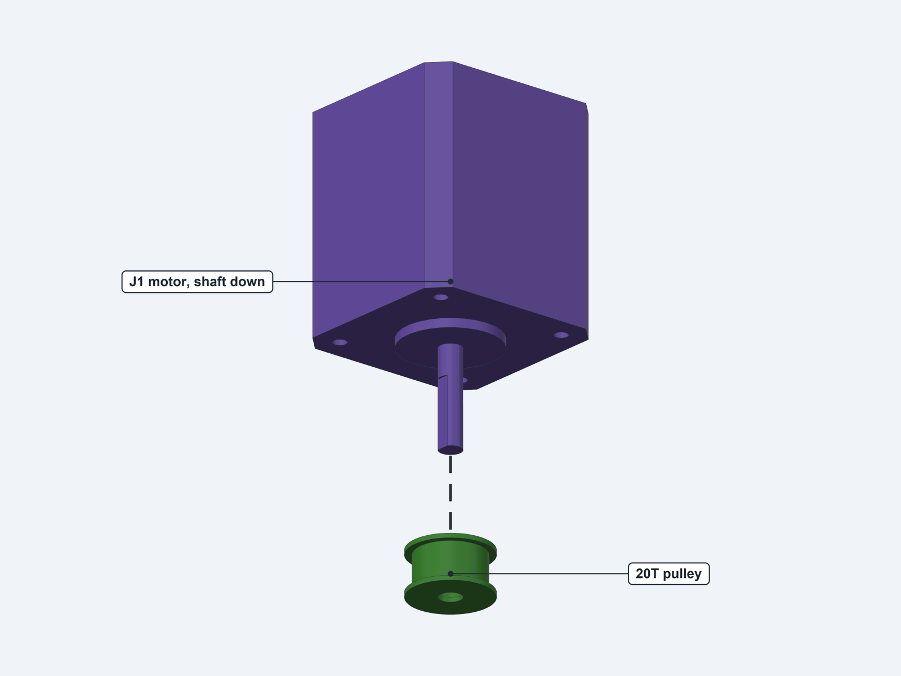

1. Slide the pulley onto the motor shaft.
2. Set it **15 mm from the motor's face to the pulley's nearest flange**, measured with a
   caliper. This lines it up with the 160T pulley's teeth.
3. Tighten its set screw onto the flat on the motor shaft.

**Check:** the pulley doesn't move on the shaft, and the distance is still 15 mm.

## Step 23: Fit the motor to the box top

**Parts:** stack, motor with pulley, 4 M3 × 16 screws.

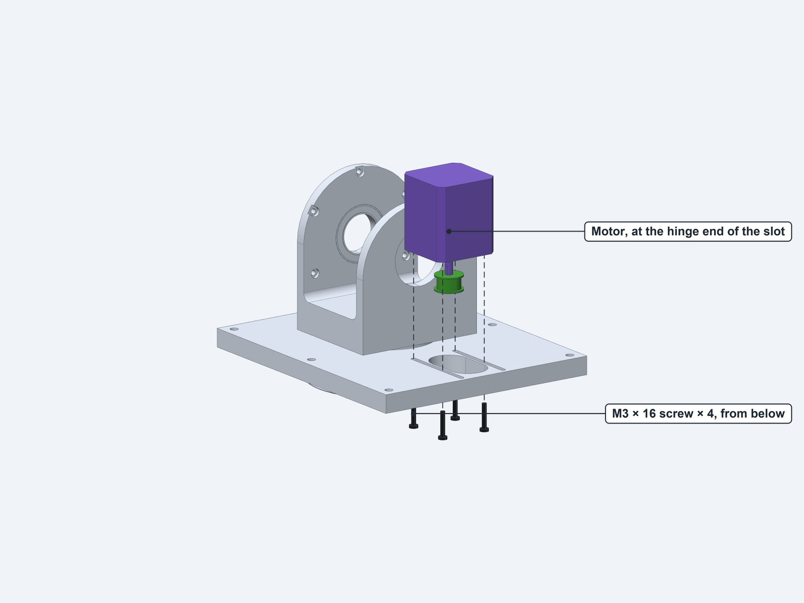

1. Turn the hinge so that one **cheek faces the motor slot**. With the motor at this end of
   the slot, the hinge's corners would hit it if turned. Keep the hinge square until step 26.
2. Lower the motor onto the box top, so that the shaft and pulley pass through the wide slot.
3. Slide it to the **hinge end of the slot**.
4. From below, fit the 4 M3 × 16 screws through the two narrow slots into the motor. Leave
   them **snug but not tight**, so that the motor can still slide.

The screws go through 12 mm of box top and about 4 mm into the motor. Don't use longer
ones: the motor's threaded holes are typically about 4.5 mm deep.

**Check:** the motor slides along the slot with light pressure and stays square to it.

## Step 24: Fit the belt

**Parts:** stack with motor, 370 mm belt.

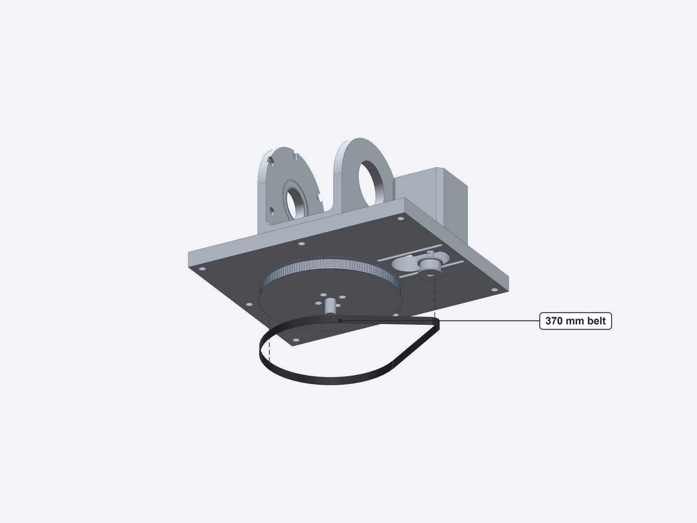

1. Hold the assembly so that you can see under the box top.
2. Loop the belt around the 160T pulley, between its flanges, and then over the 20T pulley.

The picture shows the motor where it finishes, at the far end of the slot. With the motor
still at the hinge end, as it should be now, the belt is loose and goes on easily.

**Check:** the belt sits between the flanges on both pulleys. It should look level, because
the two toothed bands are at the same height. If it doesn't, recheck the 15 mm in step 22.

## Step 25: Close the box

**Parts:** box bottom, stack with motor and belt, 7 M5 × 20 screws.

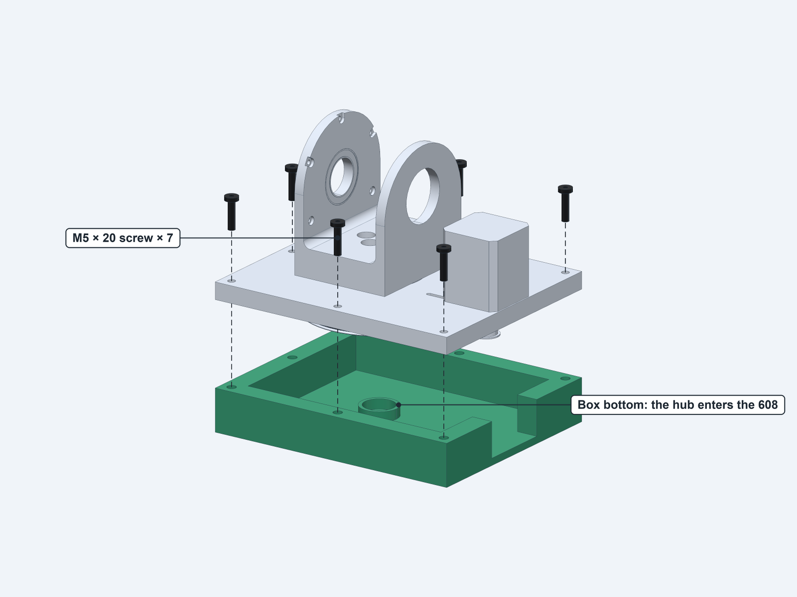

1. Stand the box bottom on the bench, with its side window toward the motor.
2. Lower the stack in, so that the pulley's hub enters the 608. Keep the belt on its
   pulleys. If the hub is tight, turn the hinge slightly as it goes in.
3. Line up the corners and fit the 7 M5 × 20 screws (**TO CONFIRM**) with the 3 mm hex key.
   They reach 8 mm into the 10.5 mm deep holes.

**Check:** the box top sits flat on the box bottom, and the hinge still turns as easily as
in step 21, as far as the loose motor allows.

## Step 26: Tension the belt and check joint 1

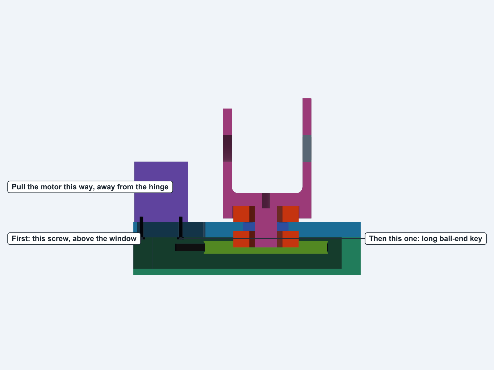

1. Pull the motor **away from the hinge**, by hand, until the belt is taut. The belt's
   length decides where the motor stops: with a 370 mm belt, its far side ends up about 1 mm
   short of the box's edge.
2. Hold it there and tighten the **two screws nearest the box's edge** first. They are just
   above the side window. Reach in with the 2 mm hex key.
3. Tighten the **other two** through the same window, with a **long ball-end key** held at
   an angle. It has to pass over the belt to reach them.

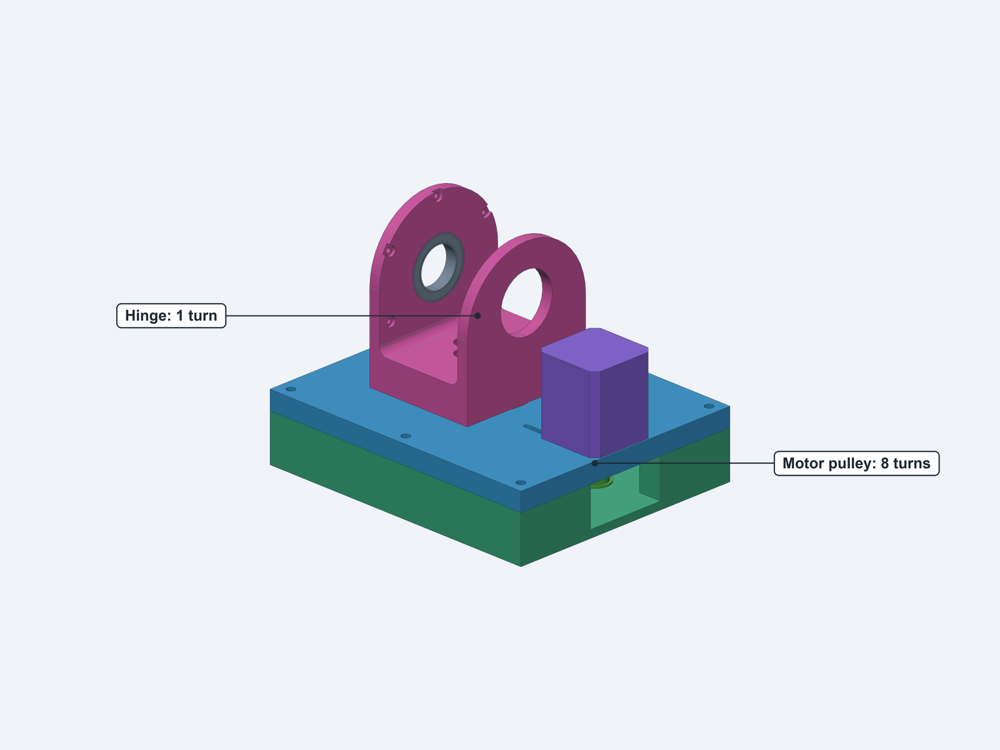

**Check:**

- Mark the 20T pulley's flange with a pen and watch it through the window. Turn the hinge
  **one full turn** by hand: the pulley turns **8 times**, and the belt doesn't skip.
- Nothing touches through the whole turn. There is no gearbox yet, so the hinge is free to
  go all the way round.
- The belt deflects a little when pressed, about 3–5 mm (**TO CONFIRM**), and the motor
  hasn't moved.

**The base is finished.** The gearbox goes on next.

## Open items: base and joint 1

| Item | What the guide assumes | Why it's open |
|---|---|---|
| Whole procedure | The order above | Worked out from the CAD and not yet followed on real parts |
| Pulley hub in the 608 (steps 16, 25) | Sand until it fits | The hub is exactly Ø8.0, with no print allowance |
| Stack height (steps 20, 21) | Turns freely when clamped | The parts and the shaft are both exactly 33 mm. Printed parts may bind or leave play |
| Clamp clearance (step 21) | M5 × 40 and nut clear the 608 | A real M5 nut leaves about 0.3 mm above the 608's seat. A taller locking nut would not fit |
| Box screws (step 25) | M5 × 20 button head, 7 in all | Calculated: 8 mm into the insert's hole. Check the assortment has this length |
| Thrust bearing grease (step 20) | The same grease as the gears | Check it's safe for the plastic |
| Belt tension (step 26) | About 3–5 mm deflection | There is no measured value yet. The belt length mostly decides it |
