# Chapter 3: Hinge and joint 2

**14:125:444 Smart Prosthetics and Robotic Systems** — Dr. Adam Gormley

[Assembly guide](assembly-guide.md) · [← Chapter 2: Base and joint 1](assembly-2-base-joint1.md) · [Chapter 4: Belt-drive arm segments →](assembly-4-arm-segments.md)

---

Joint 2 is the shoulder. The gearbox from Chapter 1 bolts to the hinge's taller cheek, and
its output hex drives the coupling shaft, a block between the cheeks that the arm will bolt
to. The output shaft and the coupling each run in a 6805 bearing in the cheeks.

**The order matters.** The coupling has to go in first: with the gearbox bolted on, its hex
would stick too far into the gap for the coupling to get past it.

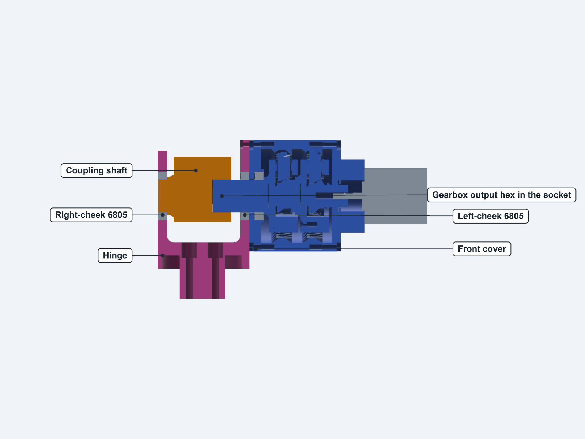

## Parts

You also need the finished gearbox from Chapter 1 and the finished base from Chapter 2.

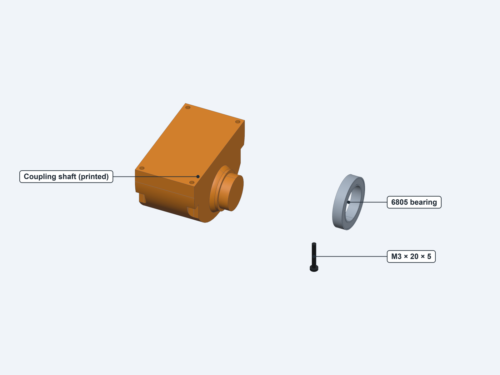

| Part | Print-list name or size | Qty | Where it goes |
|---|---|---|---|
| Coupling shaft (printed) | `coupling_shaft` | 1 | Between the cheeks |
| 6805 bearing | 25 × 37 × 7 | 1 | Hinge, shorter cheek |
| M3 button head screw | × 20 | 5 | Gearbox to hinge. Check the assortment has this length |

## Step 27: Check the fits

1. Sand any support marks off the coupling's stub and off its block's faces.
2. Try the coupling on the gearbox's **output hex**, without forcing it. It fits one flat at
   a time, so try it at several angles.
3. Try the 6805 on the coupling's **stub**, just started.

**Check:** the hex slides into the socket, and the stub starts in the bearing. Take them
apart again before continuing.

## Step 28: Put the coupling between the cheeks

**Parts:** base, coupling shaft, 6805 bearing, a small clamp, a flat plate.

The hinge stays on the base from here on, so use a small clamp in place of a vise. Turn
the hinge so that you can reach it easily.

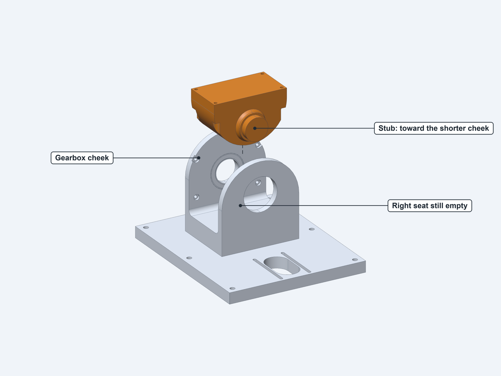

1. Point the coupling's **stub toward the shorter cheek**, whose seat is still empty.
2. Lower it between the cheeks. **The fit is exact:** the coupling is 56 mm long, and so is
   the gap, so the stub can't clear the cheek on its way down to the seat. Flex the shorter
   cheek outward a little, about 1 mm, with your hand as the coupling goes past. Once the
   stub reaches the seat, the cheek can spring back. Don't force it. In resin this is
   **TO CONFIRM**, because the parts are more brittle.
3. Let the stub line up with the empty seat, then hold the block against the **taller**
   cheek. The stub now stops just short of the seat. Rest the block on something about 15 mm
   thick on the hinge's floor, so that it stays at this height.

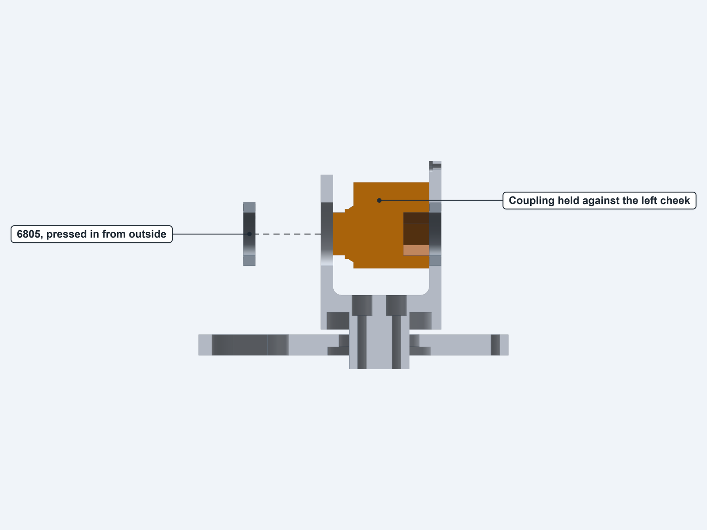

4. Start the 6805 in the shorter cheek from the outside, and put the flat plate over it.
5. Clamp between the plate and the taller cheek's outer face, gently, until the plate reaches
   the cheek. Like the other seat, this one has no shoulder, so the plate stops the bearing
   flush.

**Check:** the bearing is flush with the cheek's outer face.

## Step 29: Press the stub into the right bearing

**Parts:** a round spacer about Ø24 and 40 mm long, such as a socket from a socket set; the
flat plate; the clamp.

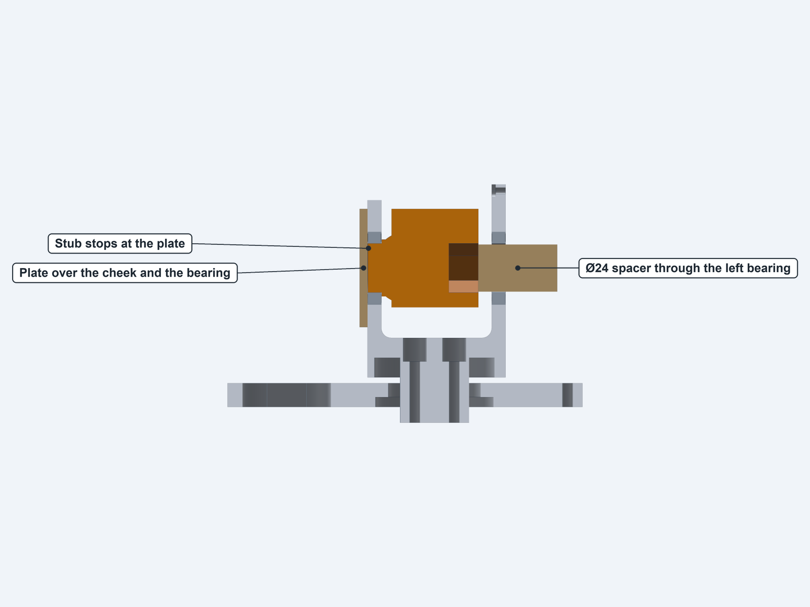

1. Keep the flat plate on the shorter cheek, covering the bearing.
2. Pass the spacer through the 6805 in the taller cheek, until it rests on the rim of the
   coupling's hex socket.
3. Line the stub up with the bearing's bore, then clamp between the plate and the spacer.
4. Close it slowly. The block moves about 7 mm until the **stub's end reaches the plate**.

This force goes straight through the coupling and the bearing's inner ring, so the cheeks
aren't loaded. If the stub goes in by hand, you don't need the clamp at all.

Take out the 15 mm block.

**Check:** the coupling turns freely by hand, until its block meets the hinge's floor at
about 80° either way. There is now a gap of about 7 mm between the block and the taller cheek.

## Step 30: Take out five front cover screws

**Parts:** finished gearbox.

The screws that hold the gearbox to the hinge use the same inserts as the front cover's
M3 × 12 screws, so five of those have to come out.

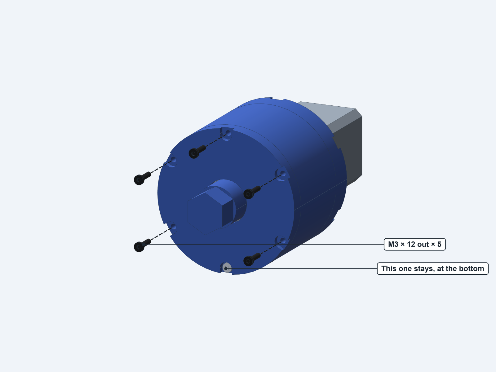

1. Hold the gearbox so that the motor mount's **access slot points sideways, level**. The
   set screw stays reachable that way, and it puts one cover screw at the very bottom.
2. Leave that **bottom screw in**. It lines up with the place on the hinge where there is no
   hole, because the hinge's floor is in the way. It keeps the cover on the ring gear.
3. Take out the other **five**. Keep them as spares.

**Check:** the cover is still seated flat on the ring gear.

## Step 31: Slide the gearbox in and start three screws

**Parts:** gearbox, 3 M3 × 20 screws.

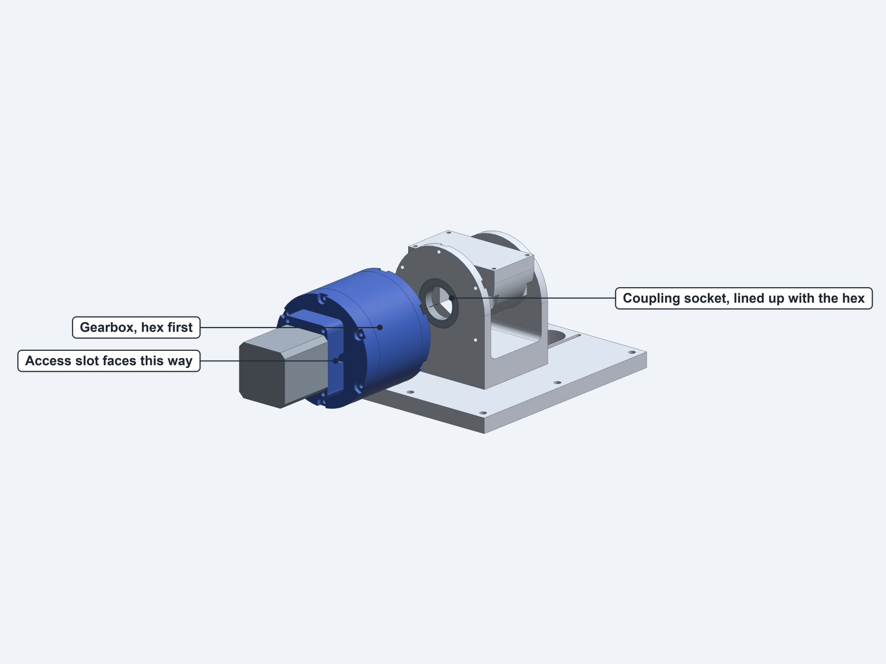

1. Turn the coupling so that its top face is level. Unplug the gearbox motor's leads: it's
   much harder to turn with its wires joined together.
2. Pass the output hex through the 6805 in the taller cheek. Keep the coupling level and turn
   the hex by hand until its flats line up with the socket, with a corner straight up. This
   turns the motor too, quickly and gently. Slide the hex into the socket. The round output
   shaft then enters the bearing's inner ring.
3. Line up the cover's holes with the cheek's, with the kept screw at the bottom and the
   access slot sideways. Push the gearbox in as far as it goes by hand.

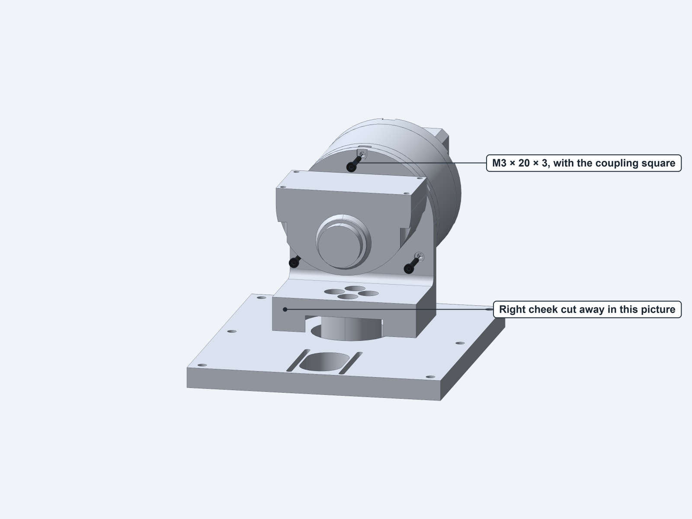

4. From **inside** the hinge, fit 3 M3 × 20 screws in the holes clear of the coupling: the
   one at the top and the two at the lower sides. Their heads sit in the cheek's counterbores.
   A short-armed 2 mm key fits in the gap.
5. Tighten them a little at a time, in turn, to **draw the gearbox in** until the cover sits
   flat on the cheek. The screws can reach their inserts once the cover is within about 6 mm
   of the cheek. If it stops turning smoothly, back off and find out why.

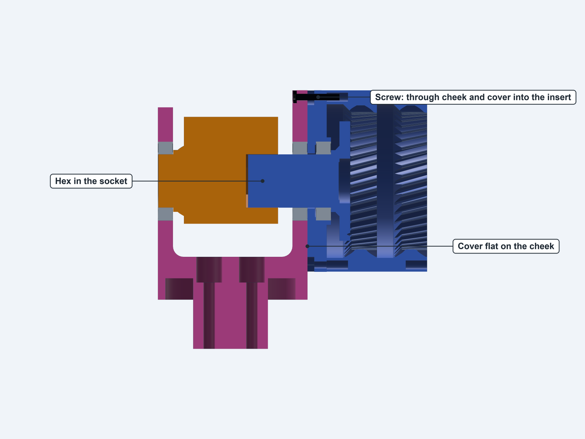

**Check:** the cover is flat on the cheek all the way round, with no gap.

## Step 32: Turn joint 2 and fit the last two screws

**Parts:** 2 M3 × 20 screws.

With the coupling level, its block covers the last two holes, at the upper sides.

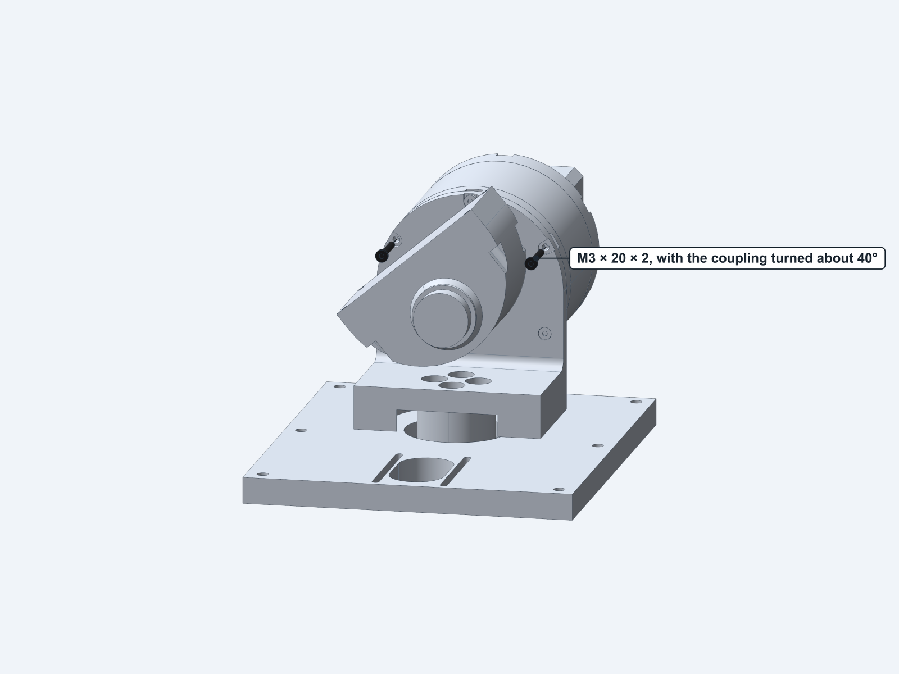

1. Turn the coupling about **40°**, either way, by hand. This turns the gearbox backward
   through 16:1, so the motor spins quickly: go gently.
2. Fit the last 2 M3 × 20 screws.
3. Tighten all five evenly, in a star pattern. Stop at snug.
4. Turn the coupling back to level.

> The screw reaches through 5 mm of cheek and 9 mm of cover, then 6 mm into the ring gear,
> which is the full length of its insert.

**Check:** all five heads sit below the cheek's inner face, and nothing touches them when the
coupling turns.

## Step 33: Check joint 2

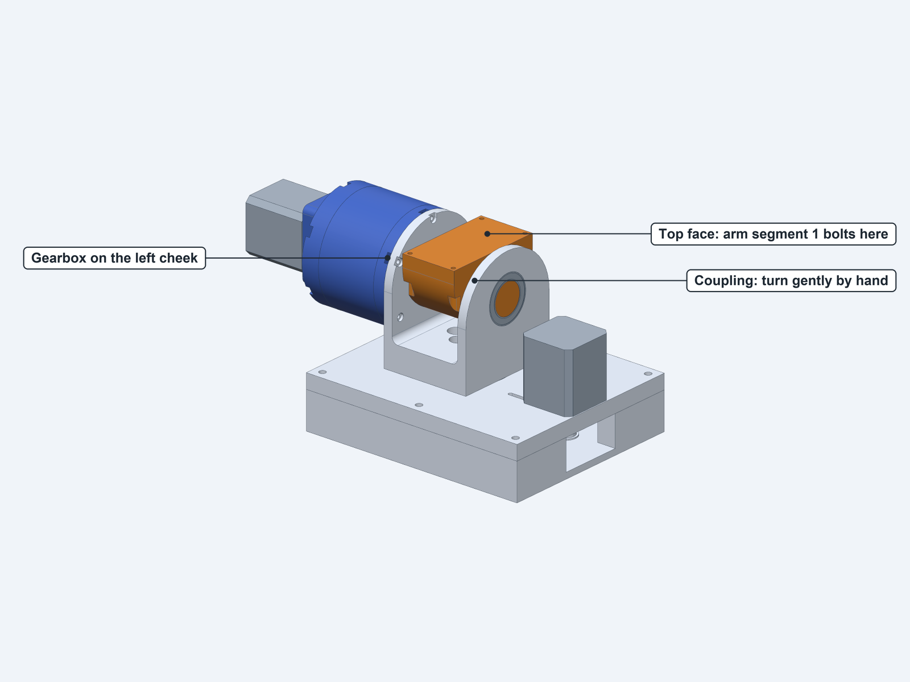

The ratio was checked in [step 11](assembly-1-gearbox.md#step-11-check-the-ratio) and can't be repeated here,
because the motor's shaft is out of reach and the coupling can't make a full turn.

**Check:**

- **Joint 2:** with the motor leads unplugged, turn the coupling gently back and forth, to
  about 75° either way. It should move smoothly, with no tight spot and no clicks. It stops
  when the block meets the hinge's floor. Don't push it against that stop: force at the
  coupling is multiplied 16 times at the motor's end, and it strains the gear teeth.
- **Binding:** this joint runs in three bearings on one line (the front cover and both
  cheeks). If it's stiff, loosen the five screws slightly and try again. If it then runs
  freely, the cover wasn't square to the cheek.
- **Joint 1:** turn the hinge about **120° either way**. The gearbox swings over the box
  without touching anything. It meets the J1 motor at about 125°, so don't go further.

**The base and shoulder are finished.** Arm segment 1, built in
[Chapter 4](assembly-4-arm-segments.md), bolts to the coupling's top face in
[Chapter 5](assembly-5-final.md). On the finished arm, joint 2's travel is about ±63°, set by
the segment's motor.

## Open items: hinge and joint 2

| Item | What the guide assumes | Why it's open |
|---|---|---|
| Whole procedure | The order above | Worked out from the CAD and not yet followed on real parts |
| Flexing the cheek in resin (step 28) | Flex the shorter cheek out about 1 mm, as on the built arm | The coupling and the gap are both exactly 56 mm, so the cheek has to flex during insertion. This may be risky in brittle resin |
| Pressing the stub (step 29) | A Ø24 spacer on the socket's rim | The spacer has to pass the Ø25 bearing bore and still land on the socket's Ø21.65 flats. Nobody has tried it yet. The stub may go in by hand |
| Drawing the gearbox in (step 31) | The first 3 screws pull it the last 6 mm | The shaft is a press fit in the cheek's bearing. If it's tight, the inserts take the load |
| Three bearings on one axis (step 33) | Runs freely | The front cover and both cheeks must line up closely (`design.md` I‑1). Print accuracy decides it |
| Turning the coupling by hand (step 32) | The gearbox can be back-driven | 16:1 through printed gears, with the motor unpowered. If it's too stiff, step 32 is hard to do |
