# Chapter 4: Belt-drive arm segments

**14:125:444 Smart Prosthetics and Robotic Systems** — Dr. Adam Gormley

[Assembly guide](assembly-guide.md) · [← Chapter 3: Hinge and joint 2](assembly-3-hinge-joint2.md) · [Chapter 5: Final assembly →](assembly-5-final.md)

---

The arm has two segments, built the same way. Each is a flat box, with a base plate, a wall
and a top plate, and it holds the drive for the joint at its far end. Segment 1 drives
joint 3 (the elbow), and segment 2 drives joint 4 (the wrist).

The motor drives the joint through two belts, each with a **20-tooth pulley driving an
80-tooth one**, for **4 × 4 = 16:1**. An idler presses on each belt, and a jack screw in the
wall pushes the idler to set the tension.

**The order matters.** Everything goes in from above with the top plate off, and the motor's
pulley and the belts can't be reached once it's on. Build the whole segment on blocks about
60 mm high, so that the motor can hang below the base plate.

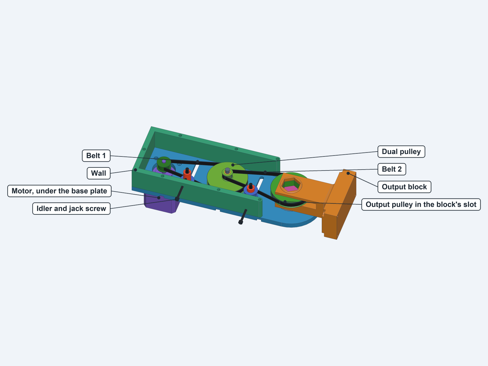

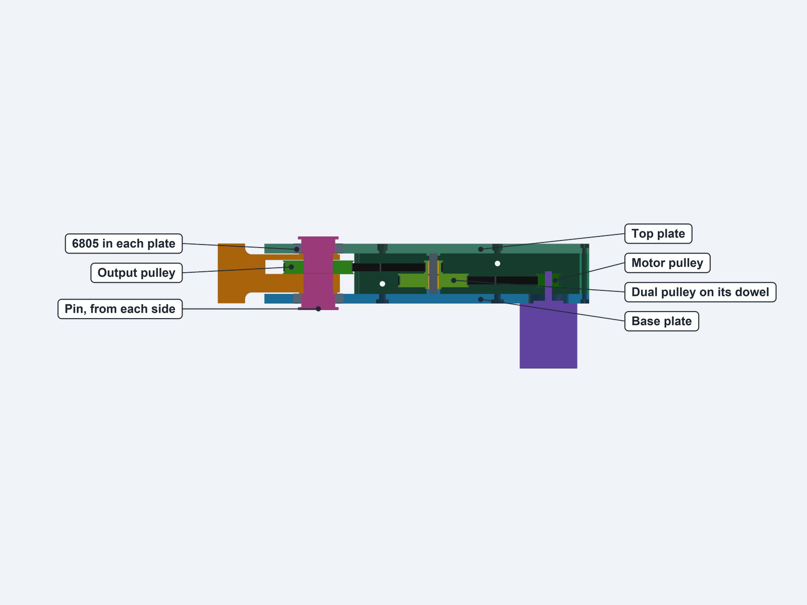

## Parts

These tables are for **one** segment. Steps 34 to 47 build segment 1, and step 48 repeats them
for segment 2.

**Printed**

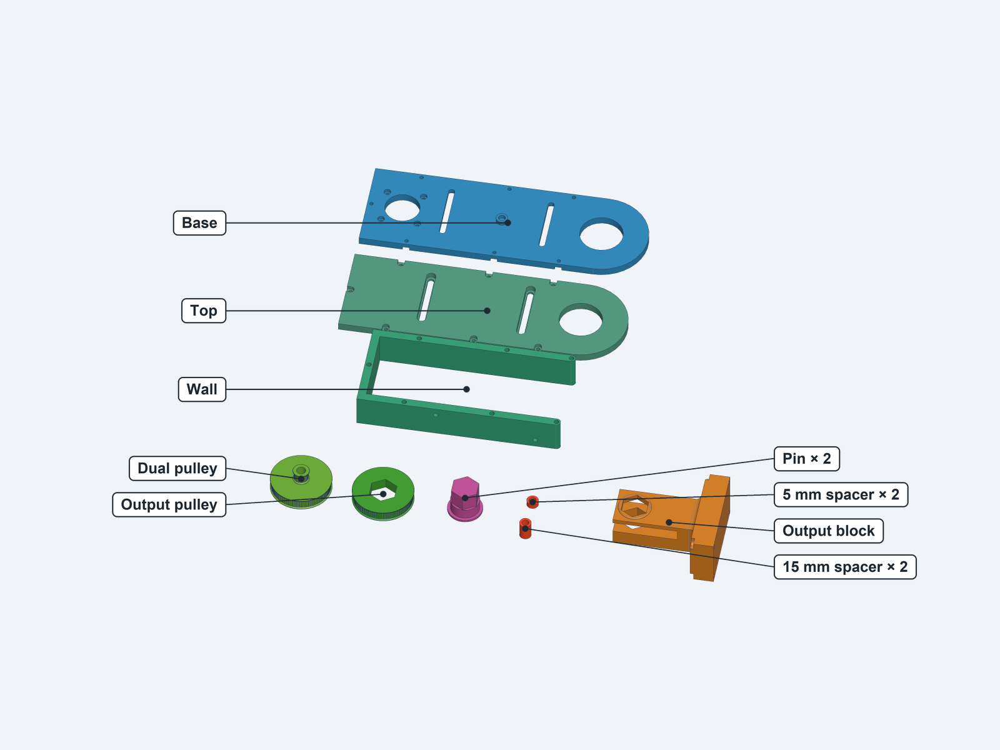

| Part | Print-list name | Qty |
|---|---|---|
| Base | `base` | 1 |
| Wall | `wall` | 1 |
| Top | `top` | 1 |
| Dual pulley | `dual_gt2_pulley` | 1 |
| Output pulley | `gt2_80_output` | 1 |
| Output block | `output_block` | 1 |
| Pin | `pin` | 2 |
| 5 mm spacer | `spacer_5mm` | 2 |
| 15 mm spacer | `spacer_15mm` | 2 |

**Bought**

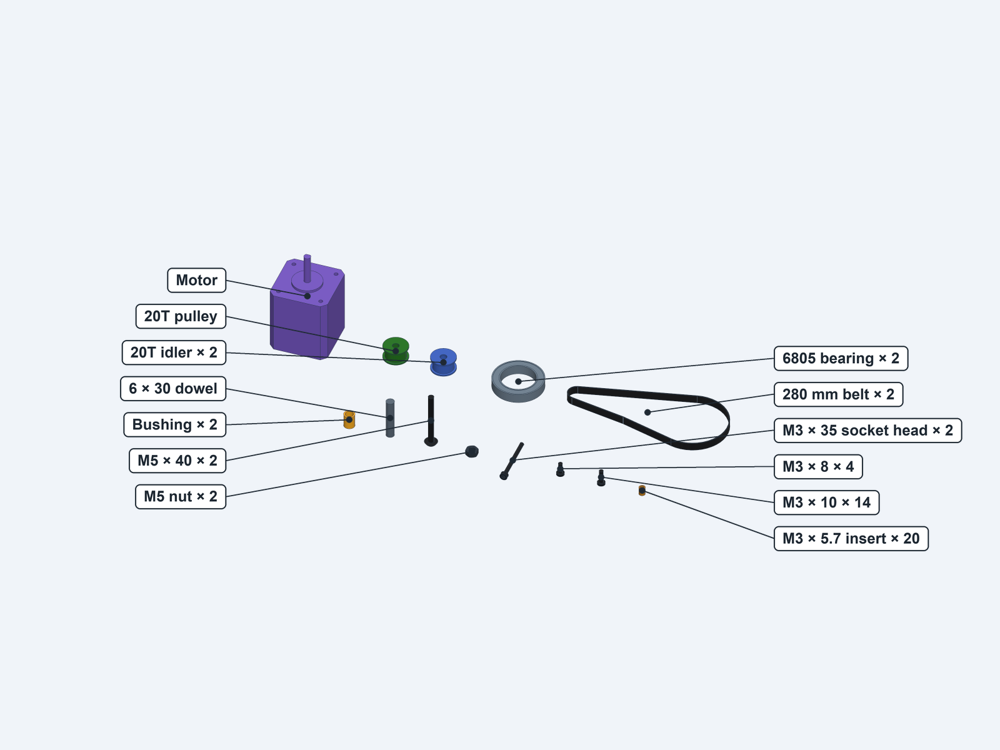

| Part | Qty | Where it goes |
|---|---|---|
| NEMA17 motor, 48 mm body | 1 | Segment 1 only. Segment 2 uses the 20 mm pancake motor |
| GT2 20T pulley, 5 mm bore | 1 | Motor |
| GT2 20T idler, 5 mm bore | 2 | One on each belt |
| GT2 closed belt, 6 mm wide, **280 mm** | 2 | One for each stage |
| 6805 bearing, 25 × 37 × 7 | 2 | Base and top plates |
| Sleeve bushing, 6 × 8 × 10 | 2 | Dual pulley |
| Dowel pin, 6 × 30 | 1 | Dual pulley's axle |
| Ruthex M3 × 5.7 insert | 20 | Wall 16, base and top plates 2 each |
| M3 × 10 button head screw (**TO CONFIRM**) | 14 | Base and top plates to the wall |
| M3 × 8 button head screw (**TO CONFIRM**) | 4 | Motor to the base plate |
| M5 × 40 button head screw | 2 | Idler axles |
| M5 nut | 2 | In the top plate's slots |
| M3 × 35 socket head screw | 2 | Jack screws |

## Step 34: Check the parts and the fits

1. Lay out every part and tick it off against the tables above.
2. Remove any support marks from fit surfaces and sand them lightly, as in step 0.
3. Try each fit dry, without forcing anything:
   - a pin's hex in the output block's socket and in the output pulley's socket, one flat at
     a time;
   - a 6805 started on a pin's round journal, and in a seat in each plate;
   - the dowel in a bushing, and in the bosses on the base and top plates;
   - an M5 nut in the top plate's 8 mm slot. It should slide, and it shouldn't turn.

**Check:** the nut slides along its slot, and the hex enters both sockets.

## Step 35: Install the threaded inserts

**Parts:** wall, base, top, 20 M3 × 5.7 inserts.

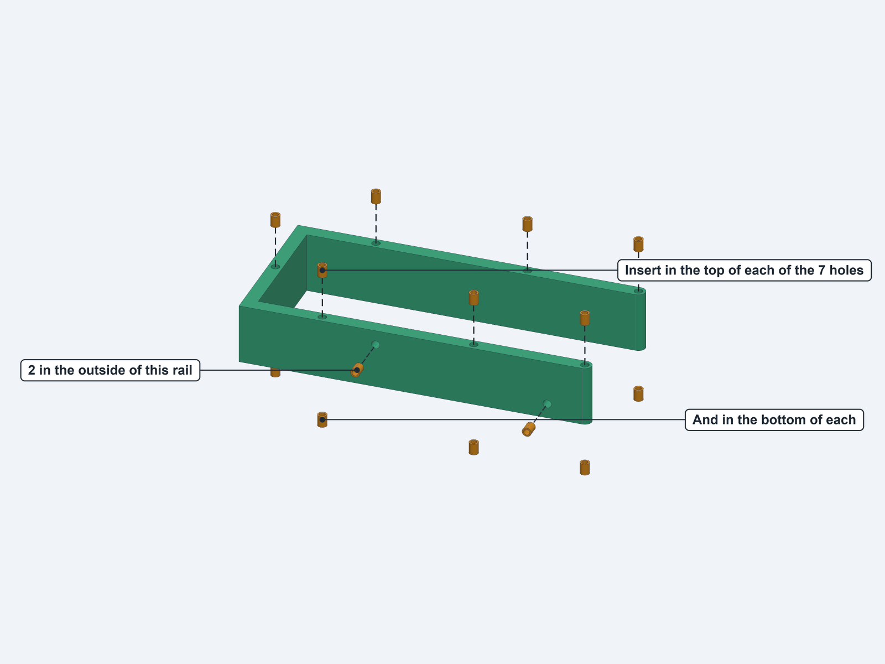

1. **Wall, 14 inserts:** one at **each end** of the seven through holes, because the base
   plate's screws come from below and the top plate's from above.
2. **Wall, 2 more:** in the two holes through the side of one rail, from the **outside**. The
   jack screws go here.

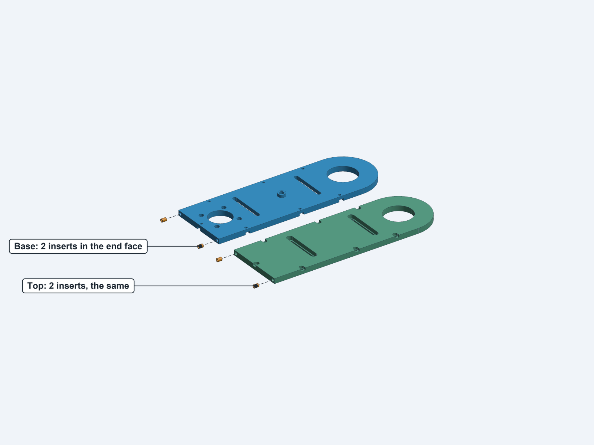

3. **Base and top plates, 2 each:** in the end face at the motor end. **Go slowly:** these
   holes leave only about 1.4 mm of plastic to the plate's faces, so too much heat or
   pressure can bulge them.

Install them as in [step 1](assembly-1-gearbox.md#step-1-install-the-threaded-inserts): heat-set in PLA, or
bonded with epoxy in resin, which needs 4–6 hours to set. **Plan ahead.**

**Check:** every insert is flush and square, and an M3 screw threads in by hand.

## Step 36: Press the bushings into the dual pulley

**Parts:** dual pulley, 2 bushings.

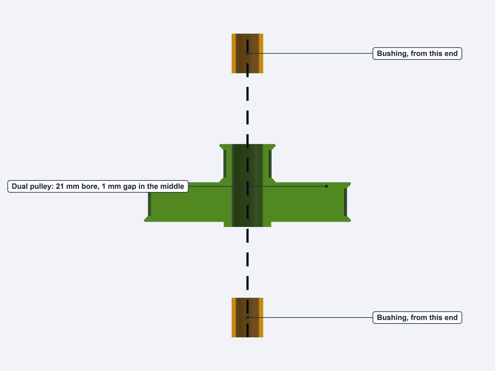

1. Start a bushing squarely in each end of the bore.
2. Press each one with a vise until it's **flush with its end of the pulley**. The bore is
   21 mm long, so the two 10 mm bushings leave 1 mm between them.

**Check:** the dowel slides and turns freely through both bushings. A bushing pressed too hard
closes up its bore, as in [step 2](assembly-1-gearbox.md#step-2-press-the-bushings-into-the-planets).

## Step 37: Press the 6805 bearings into the plates

**Parts:** base, top, 2 6805 bearings, a flat plate.

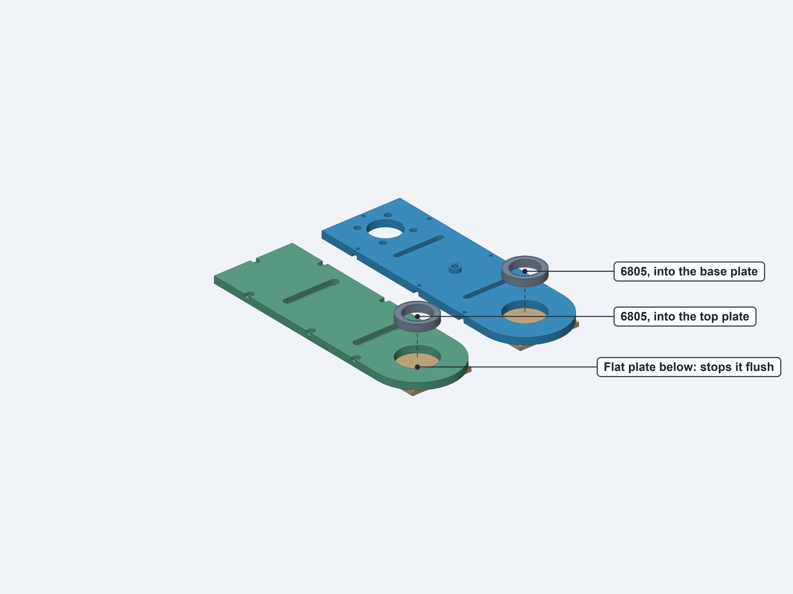

1. Stand a plate on the flat plate or surface, either way up.
2. Press the bearing into the round seat at the rounded end. This seat goes all the way through
   and has **no shoulder to stop it**: the flat surface stops the bearing, flush.
3. Repeat for the other plate.

**Check:** each bearing is flush with both faces of its plate and spins freely.

## Step 38: Bolt the wall to the base

**Parts:** base, wall, 7 M3 × 10 screws.

Do this before the motor goes on, while the base can lie flat.

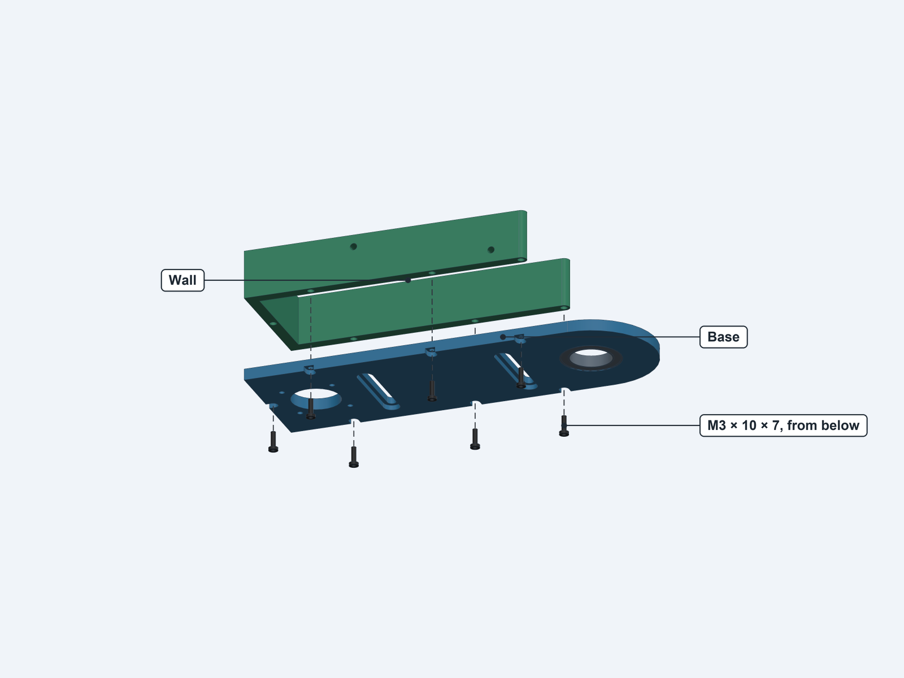

1. **The wall fits two ways, and only one is right.** Stand it on the base's inner face, the one
   with the small boss, with its closed end at the motor end: the round hole with four small holes
   around it. The rail with the two side holes goes on the side where the idler slots stop
   **farther from the plate's edge**: about 17 mm, not about 12 mm.
2. Check it from that side, with the closed end on your left: the left side hole should be
   **high** and the right one **low**.
3. Fit the 7 M3 × 10 screws (**TO CONFIRM**) from below. Their heads sit in the base's slots.
   Each goes through 4 mm of plate and all the way through the insert.

**Check:** the wall sits flat on the base all the way round.

## Step 39: Fit the motor and its pulley

**Parts:** motor, 20T pulley, 4 M3 × 8 screws.

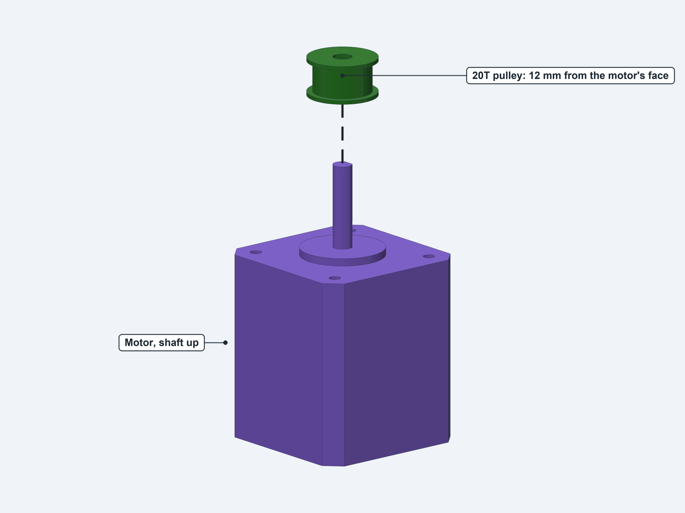

1. Slide the pulley onto the motor shaft, with its **hub toward the motor**.
2. Set it **12 mm from the motor's face to the pulley's nearest flange**, measured with a
   caliper. This lines it up with the first belt.
3. Tighten its set screw. If it lands on the round part of the shaft rather than the flat, tell
   us in the review (**TO CONFIRM**). The shaft is round for about the first 10 mm.

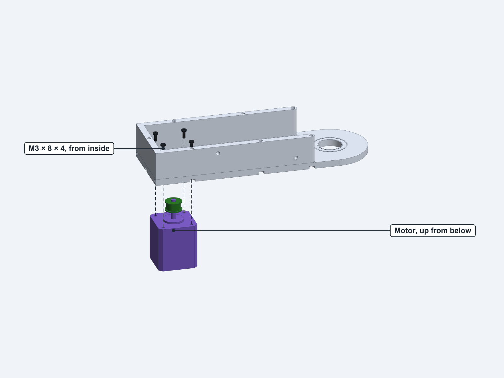

4. Put the segment on its blocks, with the motor end over the edge of the blocks.
5. Pass the pulley and shaft up through the base's large round hole.
6. Fit the 4 M3 × 8 screws (**TO CONFIRM**) from inside. Their heads sit in the Ø6 counterbores.
   They go through 4 mm of plate and 4 mm into the motor. Don't use longer ones: the motor's
   threaded holes are typically about 4.5 mm deep.

**Check:** the pulley turns freely and clears the hole, and the motor is flat against the base.

## Step 40: Fit the output pulley, the block and the first pin

**Parts:** output pulley, output block, 1 belt, 1 pin, a small clamp, a flat scrap.

The pulley goes in before the pin. Once the pin's tip is in the slot, the pulley can't get past it.

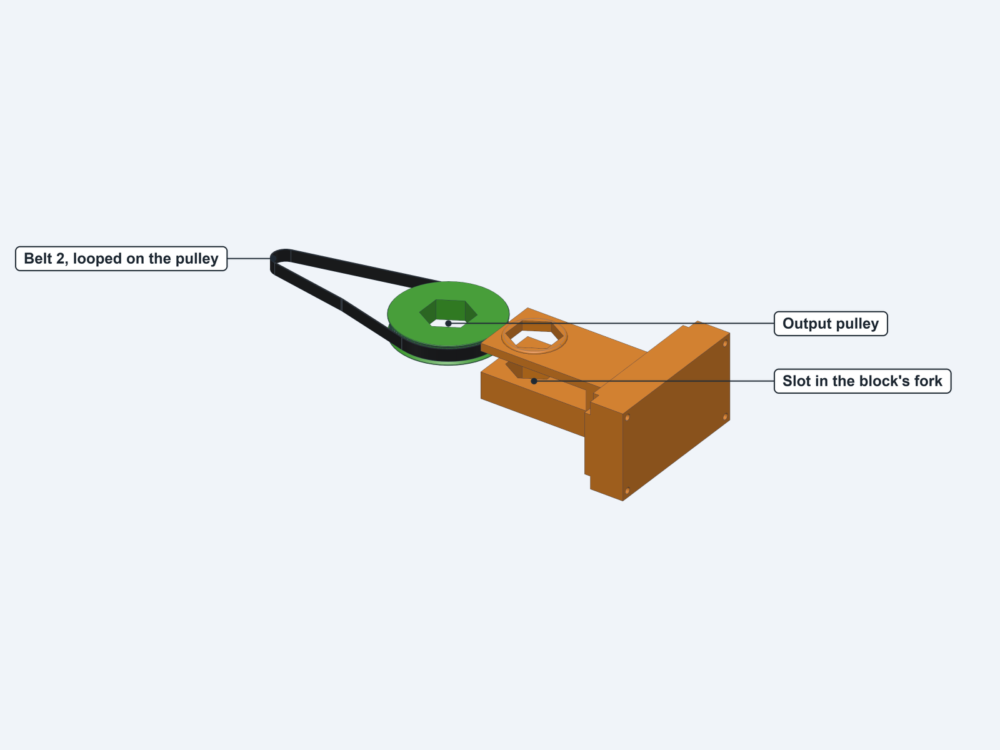

1. Loop a belt over the output pulley. It's much easier to do this now, because the pulley sits
   inside the fork.
2. Slide the pulley into the **slot in the block's fork**, from the open end. Its hex socket lines
   up with the block's. Let the belt trail out of the fork toward the motor.

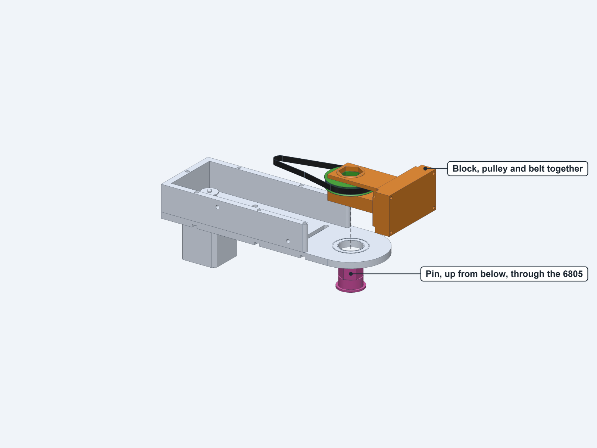

3. Lower the block onto the base, with its fork over the 6805 and its end plate past the base's
   rounded end. **The slot isn't centred: the thicker prong goes down**, toward the base plate.
4. From below, pass the pin through the 6805 and up into the block. It fits one flat at a time,
   with a corner of the hex pointing at each side rail.
5. Push it in by hand as far as it goes. If it's tight, put the flat scrap on top of the fork and
   clamp between the scrap and the pin's flange, gently. Stop when the pin stops.

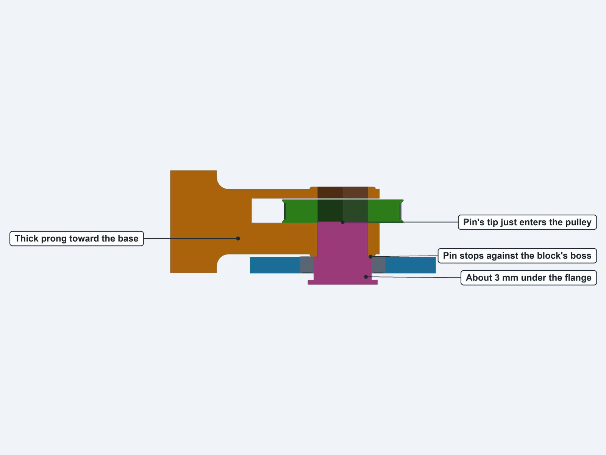

**Check:** there is a gap of about 3 mm under the flange, because the pin stops against the
block, not the plate. The block turns freely with the pin. The pulley may still turn a little,
because the pin only just reaches it. The second pin locks it in step 44.

## Step 41: Fit the dual pulley and the belts

**Parts:** dowel, dual pulley with bushings, the second belt.

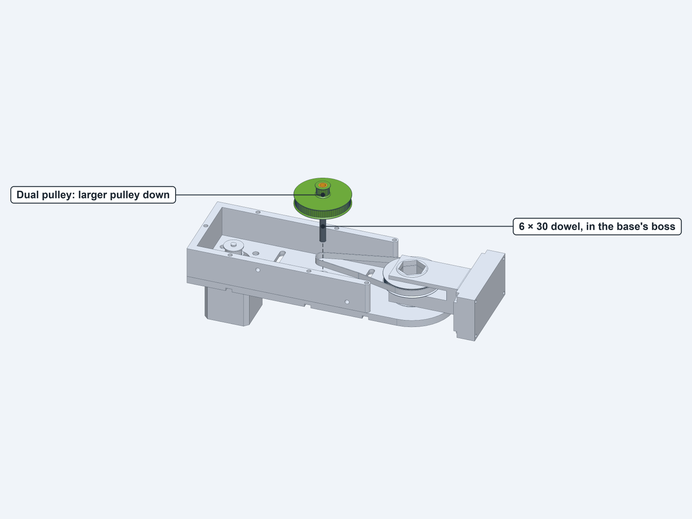

1. Stand the dowel in the socket in the base's boss.
2. Put the trailing belt's far end around the dual pulley's **small** pulley as it goes on. Slide
   the dual pulley down the dowel, with its **large pulley down**.
3. Loop the second belt around the dual pulley's **large** pulley and the motor's pulley.

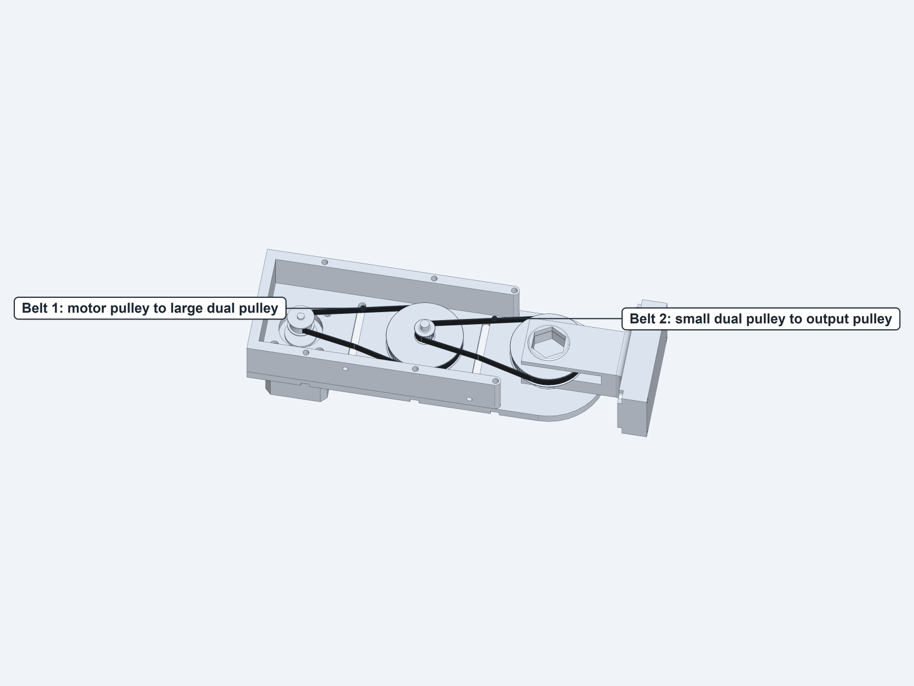

**Check:** each belt sits between the flanges at both ends, and is about level. Belt 1 is the
lower one, and it runs motor to large pulley. Belt 2 is the upper one, and it runs small pulley
to output pulley. Both are loose for now.

## Step 42: Fit the idlers and check the ratio

**Parts:** 2 M5 × 40 screws, 2 idlers, 2 5 mm spacers, 2 15 mm spacers.

**The two stacks are different.** Each idler has to line up with its own belt, so the spacers go
in the opposite order.

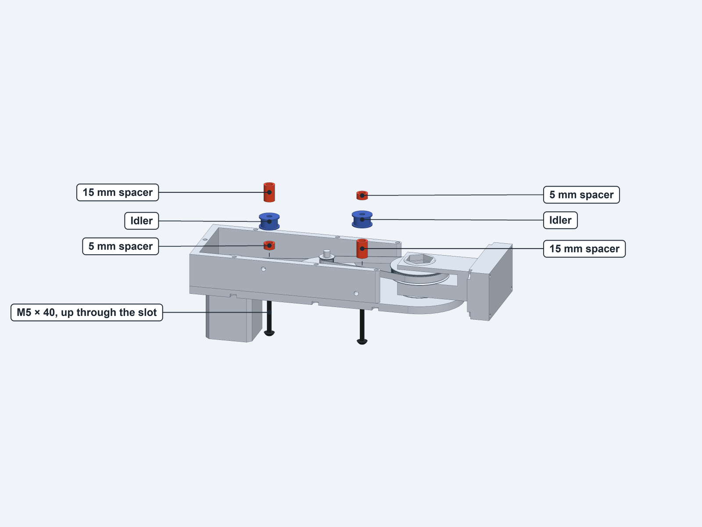

1. Push an M5 × 40 up through each slot from below. Its head sits in the wide part of the slot.
   Slide each screw to the **end nearest the jack-screw rail**.
2. **Motor-end idler (belt 1):** 5 mm spacer, then idler, then 15 mm spacer.
3. **Joint-end idler (belt 2):** 15 mm spacer, then idler, then 5 mm spacer.
4. Each idler sits on the **outside of its belt**, between the belt's smooth back and the rail.

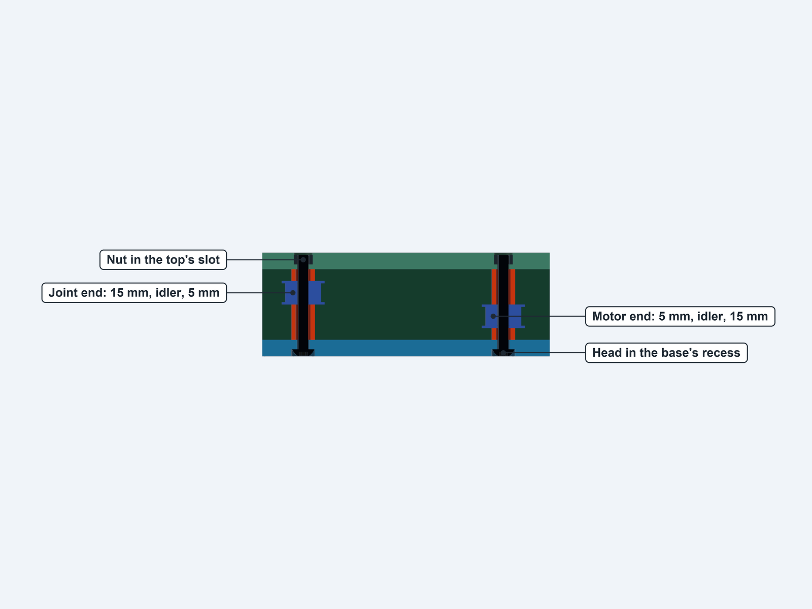

The cut-away shows how they'll end up once the top plate is on in the next step.

**Check the ratio now**, because the motor's pulley can't be seen once the top is on:

1. Drop the second pin's hex into the fork from above, by hand. This locks the pulley to the block
   for the moment.
2. Press each idler into its belt with a finger, or hold it with a rubber band, to take up the slack.
3. Mark the motor's pulley with a pen and turn it **4 times**.

**Check:** the block turns about **90°**, which is 16:1. The belts stay on their pulleys. Lift the
pin out again.

## Step 43: Close the segment with the top plate

**Parts:** top with its 6805, 2 M5 nuts, 7 M3 × 10 screws.

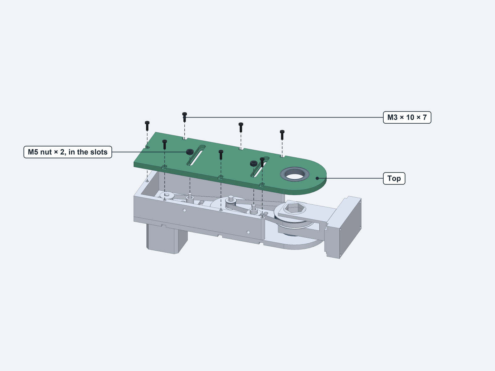

1. Lower the top plate onto the wall. Guide the 6805 onto the block, the boss's socket onto the
   dowel and both M5 screws through their slots. If the spacers lean, straighten them with a thin
   tool through the slots.
2. Fit the 7 M3 × 10 screws (**TO CONFIRM**) from above, evenly.
3. Drop an M5 nut into each 8 mm slot, flats against the walls, and start each M5 screw into its
   nut from below with the 3 mm key. **Leave them loose:** the idlers have to slide in step 46.

The dowel is exactly as long as the space between the sockets' floors, and so is the wall.

**Check:** the top plate is flat on the wall with no gap, and the block still turns freely by hand.
**If it's now stiff, stop.** The block is exactly as long as the space between the two 6805s' inner
rings (**TO CONFIRM**). Loosen the top plate and see whether it frees up. If so, report it, and
press that plate's bearing about 0.2 mm farther out, from the inside.

## Step 44: Fit the second pin

**Parts:** the second pin, a small clamp.

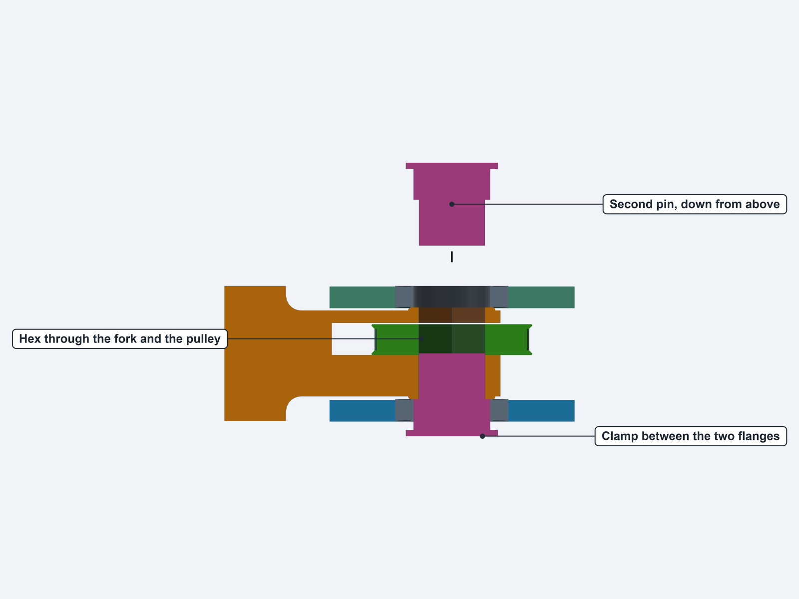

1. Look through the top 6805, and turn the belt by hand until the pulley's socket lines up with the
   block's.
2. Pass the pin through the 6805 and into the hex.
3. Push it in as far as it goes by hand. If it's tight, clamp between the **two pins' flanges**,
   gently. The force goes through the pins and the block, so the plates aren't loaded.

**Check:** about 3 mm under this flange too. The block now drives the output pulley: turn the block
slightly, and the belt moves with no play between them.

## Step 45: Fit the jack screws

**Parts:** 2 M3 × 35 socket head screws.

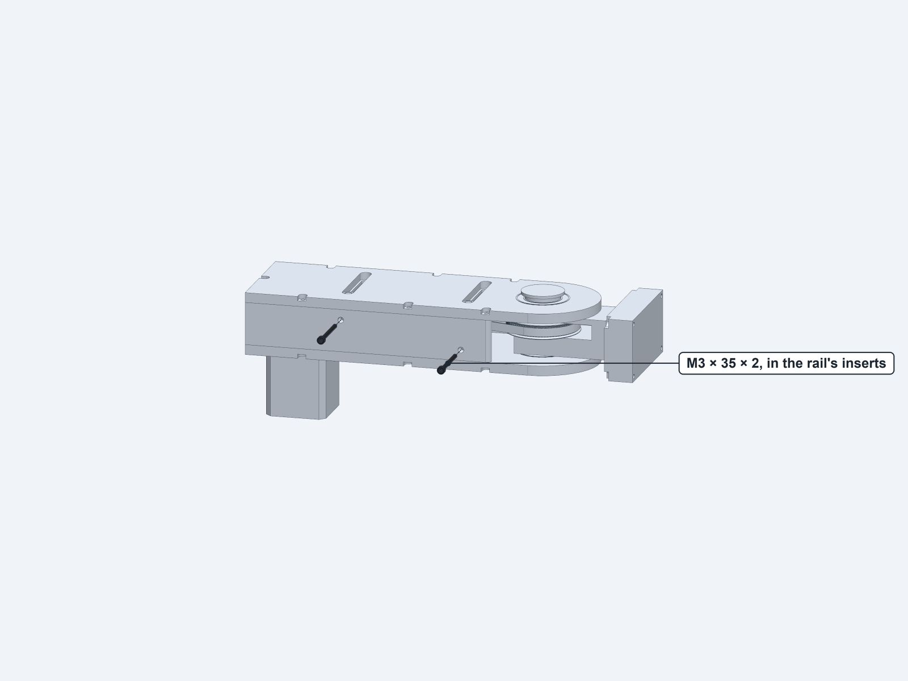

Thread one into each insert in the rail with the 2.5 mm key, until its tip just touches the
15 mm spacer inside.

**Check:** each screw turns by hand with no binding, and it's square to the rail.

## Step 46: Tension the belts

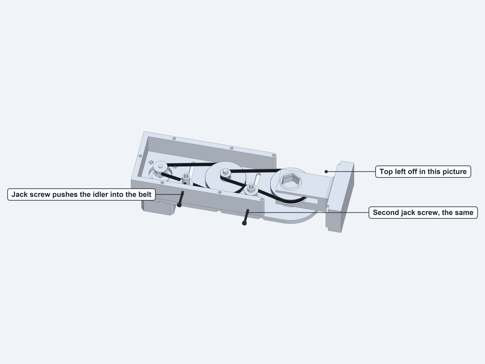

The picture shows the idlers at the slack end. A 280 mm belt ends up with its idler about **14 mm**
farther along its slot.

For each belt in turn:

1. Make sure its M5 screw is loose enough for the idler to slide.
2. Turn the jack screw **in** until the belt is taut. You can see the belt through the distal end
   and the top plate's slots. The screw only pushes, so if you go too far, back it off and push the
   idler back by turning the block both ways.
3. Hold that setting and tighten the **M5 from below** with the 3 mm key. The nut can't turn, because
   the slot holds it. This is what locks the idler, not the jack screw.

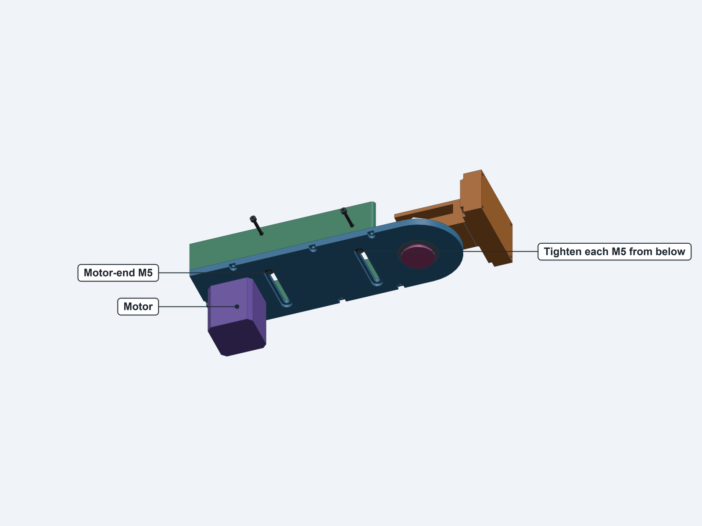

**Check:** press each belt's long side: it deflects a little, about 3–5 mm (**TO CONFIRM**). Turn
the block back and forth by hand. If a belt skips, or you can feel it riding up a flange, go back
and adjust it.

## Step 47: Check the segment

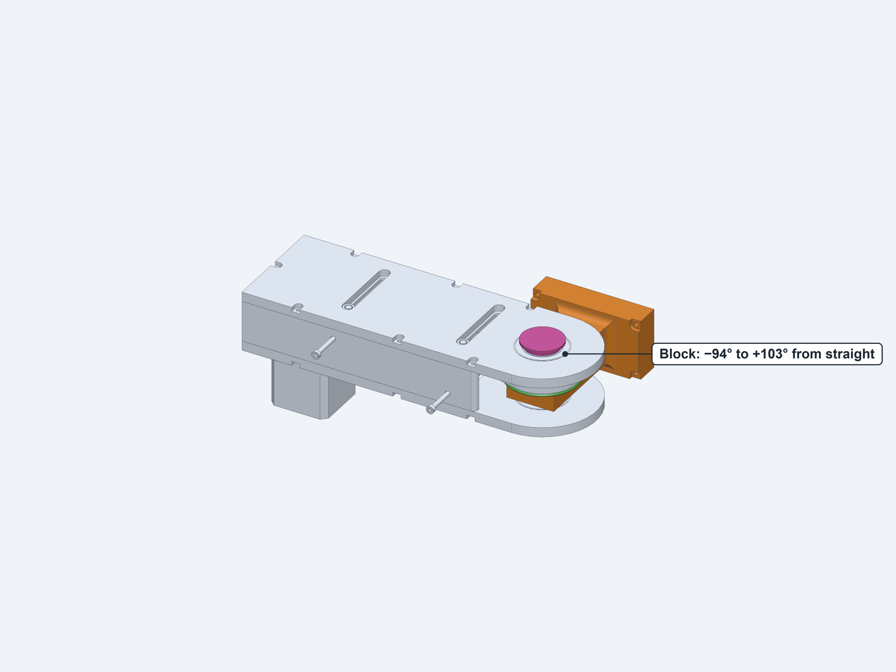

**Check:**

- **Travel:** turn the block gently from straight. It goes about **103°** away from the jack-screw
  rail, where the fork reaches the wall's other rail, and about **94°** toward it, where it reaches a
  jack screw's head. Don't push against either stop: force here is multiplied 16 times at the motor's end.
- **Feel:** it's smooth, with no tight spot and no clicking. The motor spins quickly as you turn, so
  go gently. With the motor's leads joined together, it's much stiffer.
- **Play:** rock the block lightly. A small amount of backlash is normal.

**Segment 1 is finished.**

## Step 48: Build the second segment

Repeat steps 34 to 47 with the second set of parts. The only difference is the motor: segment 2 uses
the **20 mm pancake motor**, because it's lighter and joint 4 needs less torque.

Before fitting the pulley, **measure the pancake's shaft**, from its face to its tip. The pulley's
flange still goes 12 mm from the face, so the shaft should be long enough to fill the pulley's bore, as
it was on the first motor. If it isn't, report it (**TO CONFIRM**).

**Check:** the second segment passes the same checks as the first.

**Both segments are finished.** They go onto the base in Chapter 5.

## Open items: arm segments

| Item | What the guide assumes | Why it's open |
|---|---|---|
| Whole procedure | The order above | Worked out from the CAD and not yet followed on real parts |
| Screw lengths (steps 38, 39, 43) | M3 × 10 for the plates, M3 × 8 for the motor | Calculated. The built arm's lengths weren't recorded |
| Motor pulley's set screw (step 39) | Tightens onto the shaft | Moving the pulley down to line up the belt (`design.md` I‑15) may put the set screw on the round part of the shaft. It depends on the pulley's hub length |
| Block's fit between the bearings (step 43) | Turns freely once the top is on | The block and the space are both exactly 30 mm. A thick print could load the bearings |
| Dual pulley's end float (step 41) | The belts keep it in line | It can move 3.6 mm along its dowel, and nothing but the belts holds it. It's the same in the original design |
| Belt tension (step 46) | About 3–5 mm deflection | There is no measured value yet |
| Pressing the pins (steps 40, 44) | By hand or with a small clamp | The journal is a press fit in the bearing, and nothing else holds the pin in. Report whether it stays in |
| Pancake motor's shaft (step 48) | The same length as the full-size motor's | It isn't on the listing |
