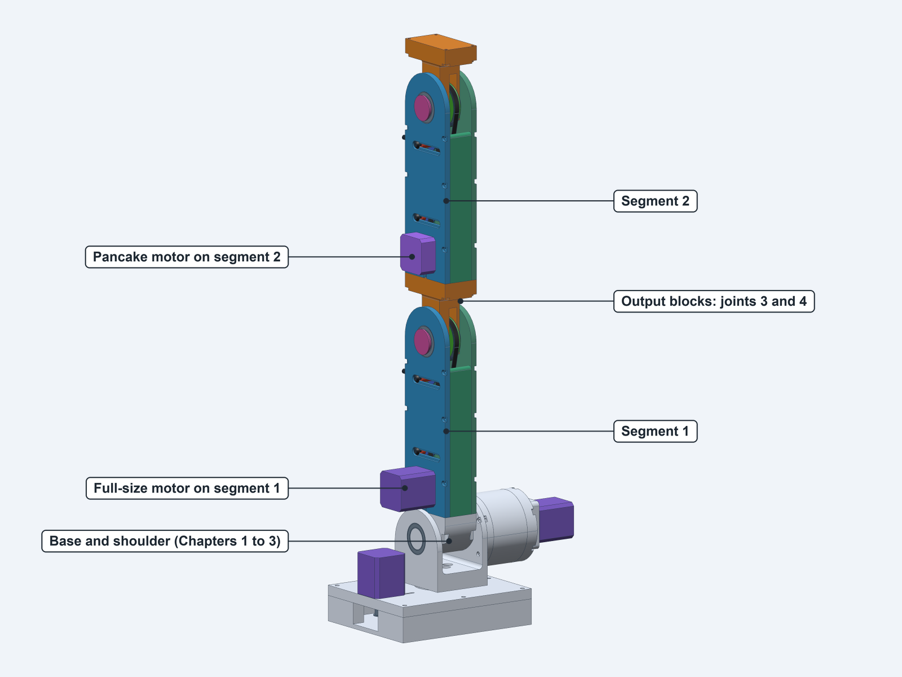
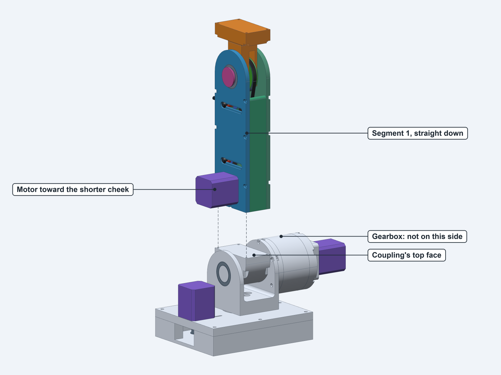
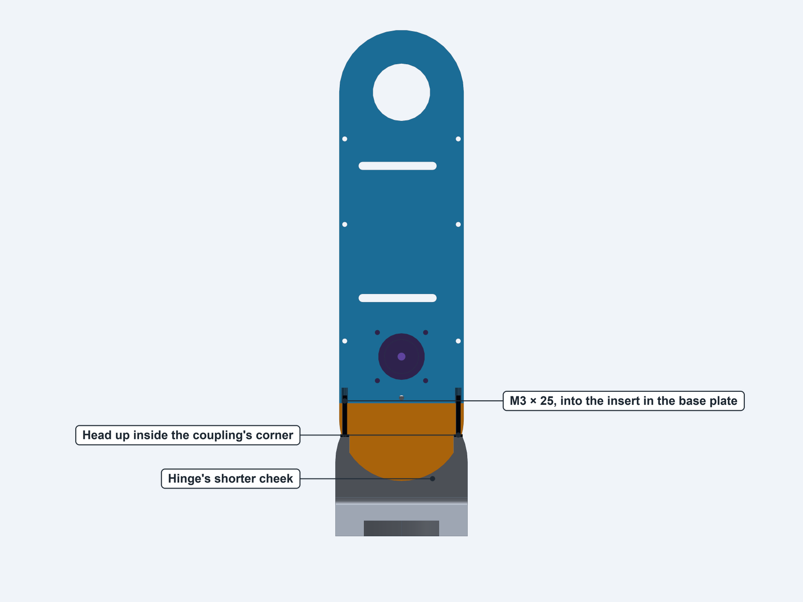
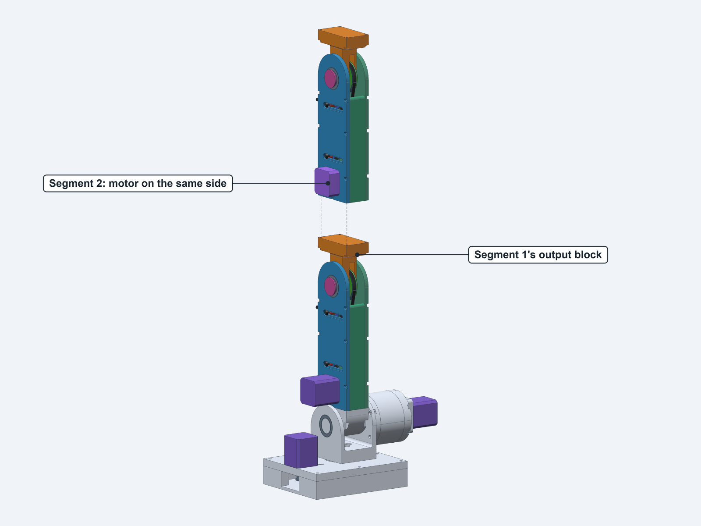
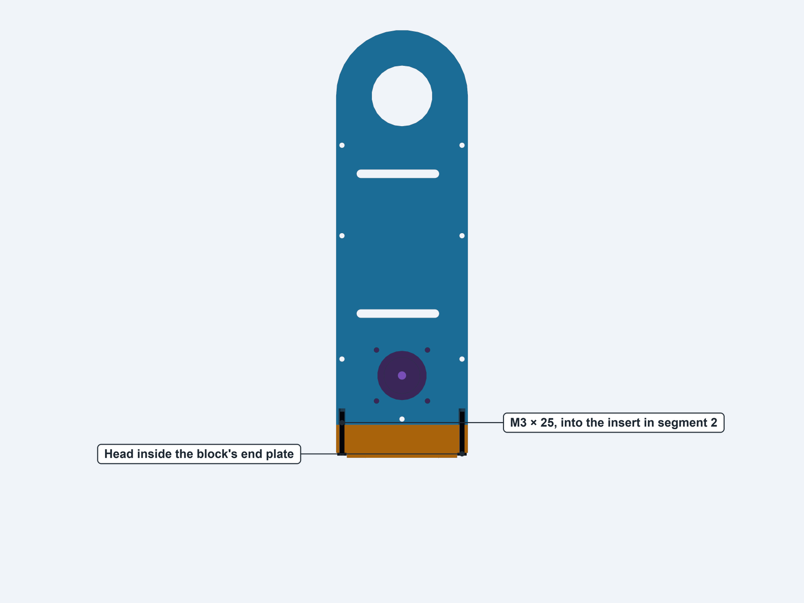
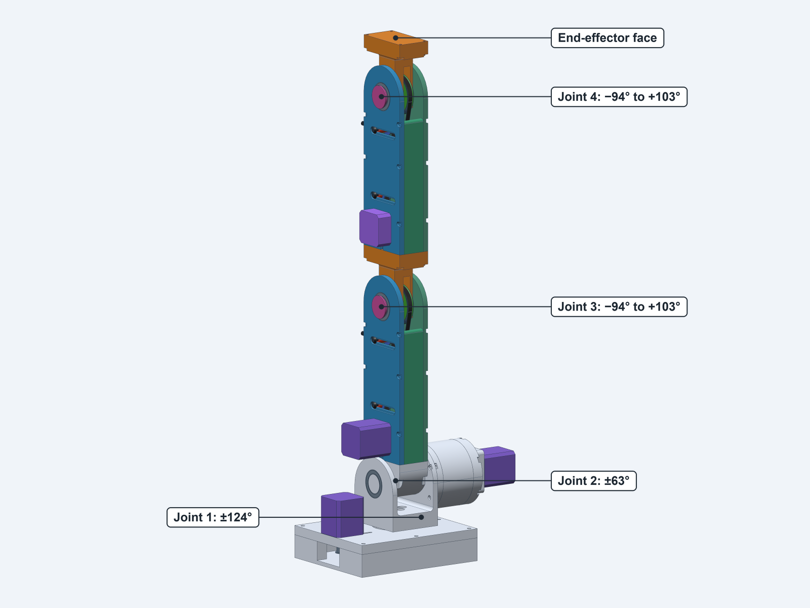

# Chapter 5: Final assembly

**14:125:444 Smart Prosthetics and Robotic Systems** — Dr. Adam Gormley

[Assembly guide](assembly-guide.md) · [← Chapter 4: Belt-drive arm segments](assembly-4-arm-segments.md)

---

The two segments bolt on in a line: segment 1 to the coupling on the shoulder, then segment 2 to
segment 1's output block. Each joint uses the same pattern of 4 M3 screws. The gripper is not part
of this guide, and neither is the wiring.

## Parts

You need the finished base and shoulder from Chapter 3 and both segments from Chapter 4.

| Part | Qty | Where it goes |
|---|---|---|
| M3 × 25 button head screw (**TO CONFIRM**) | 8 | 4 at the coupling, 4 at the output block. Check the assortment has this length |

## Step 49: Get ready

Read this before lifting anything.

1. **Fasten the base down.** The arm reaches over 600 mm above a 180 × 150 mm box, so it can tip it
   over. Clamp or weigh down the box at a clear corner of the bench (**TO CONFIRM**).
2. **Plan how to hold the arm up.** With no power, the motors won't hold it, and it will fall
   under its own weight. Work with a second person, or with a stand or box to rest it on. **Never let
   go of the arm until you have somewhere to rest it**, and keep your hands clear below it.
3. Unplug all the motor leads, so that the joints turn more easily.

**Check:** the base doesn't move when you push on the hinge.

## Step 50: Bolt segment 1 to the coupling

**Parts:** segment 1 (with the full-size motor), 4 M3 × 25 screws, a short-armed 2 mm hex key.

1. Turn the coupling so that its top face is level.
2. **The motor goes over the hinge's shorter cheek.** The screw pattern fits either way round, but
   the other way puts the motor into the gearbox.
3. Lower the segment straight down between the cheeks, with its motor end down, until its end face sits
   on the coupling.

4. From below, thread an M3 × 25 up through each corner of the coupling into the insert in the
   segment's end. Use the short arm of the key, with the long arm pointing out sideways under the
   coupling. Start all four before tightening any.
5. Tighten them evenly, in a star pattern. Stop at snug: the screw reaches about 5 mm into the
   insert.

Each corner of the coupling is open at the sides, so you can see the screw's head from below.

**Check:** the end face is flat on the coupling, with no gap. Hold the arm and turn it gently about
20° each way: nothing touches.

## Step 51: Bolt segment 2 to the output block

**Parts:** segment 2 (with the pancake motor), 4 M3 × 25 screws, a 2 mm ball-end hex key.

Keep segment 1 straight up, and have someone hold it, or rest it against a support.

1. Turn the output block so that its end face is square to segment 1.
2. Hold segment 2 over it, with its **pancake motor on the same side as segment 1's motor**. This
   pattern also fits either way round.
3. Lower it until its end face sits on the block.

4. From **inside** the end plate, thread an M3 × 25 through each corner into the insert in the
   segment's end. Each head sits in a counterbore in the end plate. Reach it with the ball-end key,
   about 10° off straight, so that it clears the plates of segment 1.
5. Tighten them evenly. Stop at snug.

**Check:** the end face is flat on the block, with no gap.

## Step 52: Check the whole arm

With someone holding the arm, turn each joint gently by hand. Stop before each limit: these are the
clear ranges from the CAD, and past them something touches.

| Joint | Clear travel from straight | What it meets next |
|---|---|---|
| Joint 1, waist | ±124° | Gearbox against the J1 motor |
| Joint 2, shoulder | ±63° | Segment 1's motor against the hinge's shorter cheek |
| Joint 3, elbow | −94° to +103° | Block against segment 1's jack screw, or against the wall |
| Joint 4, wrist | −94° to +103° | The same, on segment 2 |

**Check:**

- Each joint moves smoothly, with no tight spot and no clicks.
- All the screws from this chapter are still snug.
- The jack screws and the M5 screws can still be reached, so the belts can be re-tensioned on
  the finished arm.

The end of segment 2's output block is the **end-effector face**, with the same 4-screw pattern. The
gripper bolts on here.

**The arm is mechanically finished.** Rest it in a position where it can't fall, such as leaning on a
support with joint 2 tipped over. It won't hold itself up until the motors are powered.

## Open items: final assembly

| Item | What the guide assumes | Why it's open |
|---|---|---|
| Whole procedure | The order above | Worked out from the CAD and not yet followed on real parts |
| Screw length (steps 50, 51) | M3 × 25 at both joints | Calculated. At the coupling it reaches 5 mm into the 5.7 mm insert, and at the block it fills the insert and stops 2.2 mm short of the hole's floor. The built arm's lengths weren't recorded |
| Holding the arm (steps 49–52) | A second person or a support | The arm back-drives under its own weight. We don't have a measured holding force, and there's no built-in rest or brake |
| Fastening the base (step 49) | A clamp or a weight | The box has no mounting holes |
