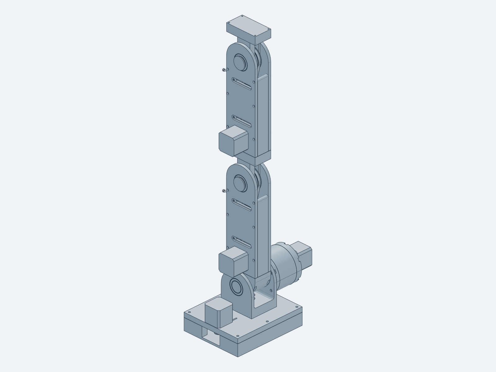
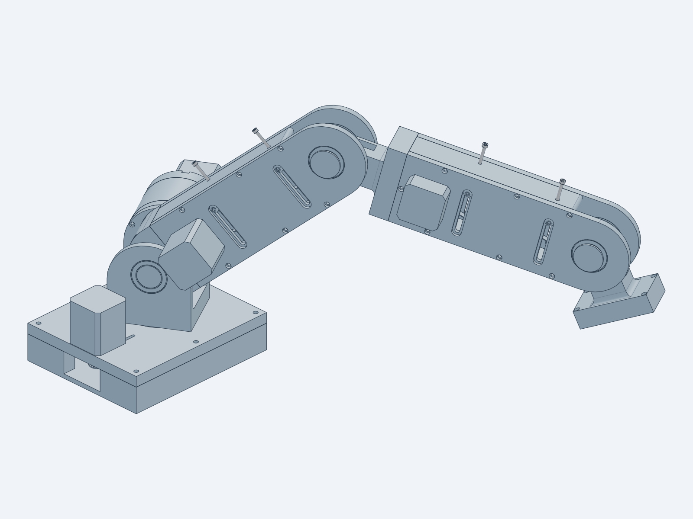

# Robotic Arm — Design Documentation (Fusion 360 baseline)

**14:125:444 Smart Prosthetics and Robotic Systems** — Dr. Adam Gormley

This document describes the reference robotic arm exactly as it exists in the three
Fusion 360 STEP exports. It is the specification for the Python
(text-to-cad / build123d) recreation.
**Nothing here is a redesign.** Flaws are recorded in
[Observed issues](#8-observed-issues-and-open-questions) and fixed later, one at a
time, after the scripted replica matches the original.

| Source file | Contents |
|---|---|
| `CAD/STEP/imported/fusion/Joint 1 and 2.step` | Base, joint 1 (waist), hinge, joint 2 (shoulder), embedded planetary gearbox |
| `CAD/STEP/imported/fusion/Planetary Gearbox - Two-stage 16to1 ratio.step` | The gearbox alone. It is geometrically identical to the copy embedded in `Joint 1 and 2.step` (every unique part matches by volume) |
| `CAD/STEP/imported/fusion/Belt Drive Arm.step` | One arm segment: belt drive and joint 3 output |

All dimensions are in mm and were measured from the STEP geometry with
`CAD/checks/inspect/dump_features.py`. The raw dumps are regenerated into
`CAD/tmp/inspect/`. Values marked *(inferred)* come from a geometry pattern,
not from a labelled feature.

---

## 1. System overview


The arm is a 4-DOF serial manipulator. Every joint is driven by a NEMA17 stepper
through a 8:1 or 16:1 reduction:

| Joint | Motion | Axis (in source frame) | Drive | Ratio |
|---|---|---|---|---|
| J1 | Waist yaw | Vertical, through (75, 75) in `Joint 1 and 2` | NEMA17 → GT2 20T → GT2 160T belt | **8:1** |
| J2 | Shoulder pitch | Horizontal ‖ X at y = 75, z = 70.5 (hinge, coupling and gearbox; Fusion had the gearbox at 70.0, [I‑1](#8-observed-issues-and-open-questions), fixed) | NEMA17 → two-stage planetary | **16:1** |
| J3 | Elbow pitch | ⟂ to the arm plates at (160, 40) in `Belt Drive Arm` | NEMA17 on segment 1 → two GT2 20T→80T belt stages | **16:1** |
| J4 | Wrist pitch | Same as J3, on segment 2 | Segment 2 is an identical copy of segment 1 | **16:1** |
| — | End effector | Bolts to segment 2's Output block (not modeled) | — | — |

The kinematic chain is: base → J1 hinge → J2 coupling shaft → segment 1 →
J3 output block → segment 2 → J4 output block → end effector. J2, J3 and J4 are
parallel, so the arm is a planar 3-link arm that yaws on J1.

**Link lengths** (measured on the assembled full arm, `src/full_arm/`, Session 6):
- Box top surface → J2: 58.5 (the gearbox axis was 58.0 in Fusion, I‑1, fixed)
- J2 axis → segment‑1 mounting face: 30.0
- J2 → J3: 230.0
- J3 → J4: 274.175 (Output block face 74.175 from J3, plus the 200 from segment 2's proximal face to its J3)
- J4 → end-effector mounting face: 74.175
- End-effector face at zero: 636.85 above the box top

**Joints in the robot frame** ([§7](#7-coordinate-frames-for-the-rewrite); zero = arm vertical). These are
the travel limits measured with `checks/joint_clearance.py`, before any contact. They are
declared as the kinematic limits of `STEP/full_arm/robot_arm.step`:

| Joint | Axis origin | Direction | Clear travel | First contact |
|---|---|---|---|---|
| J1 waist | (0, 0, 0) | +Z | ±40° (motor at mid-slot) | Hinge × J1 motor ([I‑14](#8-observed-issues-and-open-questions)) |
| J2 shoulder | (0, 0, 58.5) | +Y | ±63° | Segment‑1 motor × right hinge cheek ([I‑16](#8-observed-issues-and-open-questions)) |
| J3 elbow | (0, −21.8, 288.5) | +Y | ±103° (Fusion ±54°) | Output block fork × Wall rail end at ±104° ([I‑17](#8-observed-issues-and-open-questions), fixed) |
| J4 wrist | (0, −21.6, 562.675) | +Y | ±103° (Fusion ±54°) | Same as J3, on segment 2 |

A positive J2–J4 angle tips the arm toward +X. The segments' mid-planes are 0.2 mm
(segment 1) and 0.4 mm (segment 2) off J1 in +Y, from the coupling block (centred at
x = 74.8 in the base frame, not 75) and the Output block's 0.2 mm step.

 

**Universal M3 link interface.** Every link-to-link joint uses the same bolted
pattern: 4 × M3 on a **73 × 37 mm** rectangle. It appears on:
- the top face of the coupling shaft (J2 output);
- the proximal end face of each arm segment (heat-set inserts in the Base and Top plates);
- the distal face of each Output block (J3/J4 output).

Keeping this pattern lets segments chain together, and it is the place an end
effector attaches.

**Fusion pose.** J1 = 0, and J2 holds the arm vertical (+Z), because the
coupling shaft's mounting face points up. The arm file is modelled lying flat,
in its own frame.

**Materials.** All printed parts are FDM PLA (last offering). Resin/SLA is a
candidate for gears and pulleys in the redesign.

---

## 2. Base and joint 1 (`Joint 1 and 2.step`)

### Load path and drive
1. **Motor.** The J1 NEMA17 (not in Fusion; added in the recreation at mid-slot, I‑8) sits on top of `Box top` with its
   shaft pointing down through a slot. A stock GT2 20T pulley on the shaft sits
   in the 30 mm cavity under the top plate.
2. **Belt and tension.** The belt runs to the `GT2-120` pulley, which actually
   has **160 teeth**. The motor slides 20 mm in the slot (center distance 65–85)
   to tension the belt.
3. **Axial clamp.** The pulley bolts to the bottom of `Hinge` with 4 × M5 at
   r = 10. This clamps a stack on the hinge's Ø35 shaft: hinge → upper thrust
   bearing 40×60×13 → `Box top` → lower thrust bearing → pulley. That stack
   carries the axial and tipping loads.
4. **Radial bearings.** A 6807 (35×47×7) seated in `Box top` and a 608 (8×22×7)
   on the pulley's Ø8 hub, seated in `Box bottom`.

### Parts

| Part (Fusion name) | Qty | Make | Envelope | Key features |
|---|---|---|---|---|
| `Box bottom v5` | 1 | Print | 180 × 150 × 30 | 15 mm walls, 5 mm floor, open pocket 150 × 120. 608 seat Ø22 on a Ø27 boss (z 5–12). 7 × M5 heat-set insert holes Ø6.4 × 10.5 deep (z 19.5–30) at x ∈ {7.5, 90, 172.5}, y ∈ {7.5, 142.5}, plus (7.5, 75). Side window in the +X wall at y 50–100 (wire/belt access). |
| `Box top v6` | 1 | Print | 180 × 150 × 12 | 7 × M5 clearance Ø5.3 matching the inserts. Ø60 × 5 recess on the underside (lower thrust bearing). Ø47 × 7 seat on top (6807). J1 motor slot: 25 wide, centers x = 140…160, y = 75. Two M3 slots (3.3 wide) at y = 59.5 / 90.5, x = 124.5…175.5 (31 mm NEMA17 pattern, sliding). |
| `Hinge v8` | 1 | Print | 70 × 85 × 121 | Vertical Ø35 shaft (33 long, through the 6807 and both thrust bearings). Ø61 × 10 pocket on the underside for the upper thrust bearing. 4 × M5 Ø5.3 at r = 10 with Ø12 counterbores. Two 7‑mm cheeks (x 0–7 and 63–70) with rounded R42.5 tops and Ø37 × 7 6805 seats on the J2 axis. R5 fillets along Y where the floor (z 15–35) meets each cheek (Session 1 listed these as Ø10 cable holes; corrected in Session 4). The left cheek has 5 × M3 (Ø3.3 + Ø6 × 2 counterbore from the inside) on r = 39.25 about J2 for the gearbox front cover; the 6th hole of the hexagonal pattern is missing. |
| `GT2-120 v4` (actually 160T) | 1 | Print | Ø103.35 × 22 | GT2 160T: OD 101.35, tooth width 7 (z 0–7), between 1.5 mm flanges that rise at 45° to Ø103.35 with 0.2 mm chamfers. Ø60 × 5 pocket (lower thrust bearing). Ø8 hub, 12 long, into the 608. 4 × Ø5.3 at r = 10. |
| `Coupling shaft v1` | 1 | Print | 50 × 80 × 56 | J2 output and segment‑1 mount. Block with an R40 rounded end. Hex socket **21.65 AF** (circumradius 12.5, corners vertical), 15 deep, takes the gearbox output hex (21.48 AF since the I‑2 fix). A curved Ø33 → Ø29 transition, a Ø29 × 2 shoulder and a Ø25 × 7 stub that runs in the right-cheek 6805. Top face carries the **73 × 37 M3 link interface** (Ø3.3 + Ø6 counterbore). |
| Thrust bearing 40×60×13 | 2 | Buy | | |
| 6807 bearing 35×47×7 | 1 | Buy | | |
| 608 bearing 8×22×7 | 1 | Buy | | |
| 6805 bearing 25×37×7 | 2 | Buy | | In the hinge cheeks (J2) |
| NEMA17 + GT2 20T 5 mm bore (J1) | 1 | Buy | | Not in Fusion. Added in the recreation (Session 4): mounting face on `Box top`, mid-slot (x = 150), 20T band centred on the 160T band (z −12…−4) |
| GT2 closed belt, 6 mm (J1) | 1 | Buy | | Pitch length 340–373 over the slot range (356 at mid-slot); exact belt unknown |
| M5 bolts + inserts, M3 screws | — | Buy | | Lengths not recorded |

---

## 3. Planetary gearbox, joint 2


This is a **two-stage simple planetary with one shared ring.** Both stages use
**15° helical gears, transverse module 1.5, 20° pressure angle, no profile shift** (corrected in Session 3: the teeth twist uniformly, so they are helical, not spur):
- sun **15T** (OD 25.5, root 18.75);
- planets **15T**;
- ring **45T** internal (root Ø70.9).

Ring = sun + 2·planet (45 = 15 + 30). The planet center radius is 22.5.
Each stage has 3 planets, which assemble evenly because (15 + 45)/3 = 20 is an
integer. The ratio per stage is 1 + 45/15 = **4**, so the total is **16:1**.
Face width is 9 (planets). Hands: the ring and planets are right-hand (the tooth pattern turns CCW about the gearbox +Z axis toward the motor), the suns left-hand. All teeth are thinned by about 0.053 mm at the pitch circle (backlash allowance; the ring teeth are 3.91° wide against a nominal 4.0°). The ring's tip is Ø64.0 (addendum 1.167 m) and its root Ø70.9 (dedendum 1.133 m). The ring has two separate 12 mm toothed bands, one per stage, with a Ø72 relief groove between them; each band ends in a 45° chamfer. The suns and planets have root fillets of about 0.635 mm (0.42 m), and their tips are chamfered 0.4 mm at both faces. The ring's tooth tips are rounded about 0.385 mm. These radii were fitted to the Fusion section areas.

### Power path
1. **Input.** NEMA17 (5 mm shaft) → `Input shaft`, a stage‑1 sun with a Ø5.3
   bore and a Ø4 radial set-screw hole. It is supported by a 17×26×5 bearing in
   `Back cover` and a 12×21×5 bearing.
2. **Stage 1.** Three planets on 6 mm pins drive the stage‑1 carrier, which is
   two halves: `Carrier p1 - stage 1` + `Carrier p1 - stage 1 - Output`. The
   output half carries the **stage‑2 sun** (15T) and a Ø12 journal in a second
   12×21×5 bearing.
3. **Stage 2.** Three planets drive the stage‑2 carrier: `Carrier p1 - stage 2`
   + `Carrier p2 - stage 2 - Output`.
4. **Output.** The output carrier has a Ø25 shaft (30 long in Fusion, 24.3 since the I‑2 fix), running in the gearbox
   `Front cover` 6805 **and** the left hinge-cheek 6805. It ends in a
   **21.48 AF × 14.5 hex** (Fusion: 21.65 AF × 15) that drives the `Coupling shaft`.

### Parts

| Part | Qty | Make | Envelope | Key features |
|---|---|---|---|---|
| `Ring gear` | 1 | Print | Ø85 × 47 | 45T internal, m1.5, runs both stages. Ø72 × 7.7 counterbore at the motor end. 6 × M3 heat-set insert holes Ø4.2 × 10 at r = 39.25 in **both** end faces (30° + 60k). |
| `Back cover v2` | 1 | Print | Ø85 × 14 | Ø72 pilot into the ring. Ø26 seat (17×26×5 bearing). 6 × M3 Ø3.3 on r = 39.25 with Ø7.5 × 3.2 pockets that run out radially to the rim as open U-slots. Ø72 × 7 recess for the stage‑1 carrier. 4 × M3 inserts Ø4.2 × 6 on a 33 × 48 rectangle for `NEMA17 mount`. |
| `NEMA17 mount` | 1 | Print | 41 × 56 × 10 | Motor 31 × 31 M3 pattern (Ø3). Ø24 boss bore. 4 × Ø3 on 33 × 48 to the back cover, with Ø10 head counterbores. Ø3.5 radial hole. |
| `Input shaft v5` | 1 | Print | Ø25.5 × 36.4 | 15T sun, 10 wide. Journals Ø11.94 (12×21×5 bearing) and Ø16.94 (17×26×5 bearing). Ø5.3 motor bore; Ø4 cross hole for a set screw. |
| `Carrier p1 - stage 1` / `Carrier p1 - stage 2` | 1 + 1 | Print | Ø56 × 19 | Same geometry, two occurrences. 3 × Ø6 pin holes at r = 22.5. 3 × Ø29.5 planet pockets. 3 × M3 insert Ø4.2 at r = 22, offset 60°. |
| `Carrier p1 - stage 1 - Output` | 1 | Print | Ø56 × 29 | Mating half plus the stage‑2 sun 15T. Ø12 journal. 3 × Ø6 pin holes. 3 × Ø2.8 pilot holes (M3). |
| `Carrier p2 - stage 2 - Output v5` | 1 | Print | Ø56 × 47.8 | Mating half plus the Ø25 × 24.3 output shaft (Ø29 shoulder) and the 21.48 AF hex (Pin size), 14.5 long, flat normal at 0° (corners on gearbox ±Y = base ±Z). Fusion: Ø56 × 54, Ø25 × 30 shaft, 21.65 AF × 15 hex at −16.54° (I‑2). |
| `Front cover v3` | 1 | Print | Ø85 × 11 | Ø37 × 7 6805 seat. Ø41 × 2 relief. 6 × M3 Ø3.3 on r = 39.25 with Ø7.5 × 3.2 pockets running out to the rim as open U-slots. Bolts to the ring gear and to the hinge left cheek. |
| `Planet gear` | 6 | Print | Ø25.5 × 9 | 15T, Ø8 bore for the bushing. |
| `Pin 6x11mm` | 6 | Buy | Ø6 × **22** | The name says 11 mm, but the part is 22 long |
| `Bushing 8mm` | 6 | Buy | 6 × 8 × 10 | Planet bushing (bronze/PTFE *(inferred)*) |
| `Washer 6mm` | 12 | Buy | 6.2 × 11.8 × 1.3 | Two per planet |
| Bearing 12×21×5 (6801) | 2 | Buy | | |
| Bearing 17×26×5 (6803) | 1 | Buy | | |
| Bearing 25×37×7 (6805) | 1 | Buy | | Front cover |
| NEMA17, 20 mm shaft | 1 | Buy | | |

---

## 4. Belt drive arm segment (joints 3 and 4)


### Structure
The segment is a 240 × 80 × 44 box with an R40 rounded distal end, built from
three printed plates fastened with M3 screws into heat-set inserts:
- `Base`, 7 thick, with bosses to 10.7;
- `Wall`, a 30-tall U-frame (7-wide side rails, 7-thick proximal end wall, open at the distal end). Since the I‑17 fix the rails end at x = 130 (Fusion: 160, at J3), clear of the Output block fork's sweep;
- `Top`, 7 thick.

The proximal end faces of Base and Top carry Ø4.2 insert holes (x‑axis, at
y = 3.5 / 76.5 and z = 3.5 / 40.5), which form the 73 × 37 link interface.

### Drive (16:1)
1. NEMA17 under `Base` at (−10, 40), pilot through Ø30, M3 on the 31 mm pattern.
2. GT2 **20T** (COTS, 5 mm bore) drives `Dual GT2 pulley` at (75, 40): **80T**
   driven, then **20T** driver. It turns on two 6×8×10 bushings on a 6×30 dowel pin.
3. The dual pulley drives `GT2-80 output` (80T), which is keyed by a **21.65 AF
   hex socket** (circumradius 12.5, the same as the coupling shaft) onto two
   `Pin` hex shafts. It sits on J3 at (160, 40). Fusion places it at
   (165.59, 47.15), 9.08 mm off the axis ([I‑6](#8-observed-issues-and-open-questions), fixed in the recreation).
4. The intended center distance is 85 for both stages, which gives a 274.3 mm
   open-belt pitch length. (In Fusion, stage 2 is 90.87, open belt 285.8 mm, I‑6.)
   A 280 mm (140T) loop *(inferred)* would be taken up by the idlers.
5. Each belt has a `GT2-20 idler` on a 6×30 dowel pin with 5 / 15 mm spacers.
   The dowels sit in **slots in both plates (y 20 ↔ 65)**, so the idler slides to
   tension the belt: Base Ø10 × 3 from below, then Ø5.3; Top Ø5.3 × 2, then Ø8
   from above. The dowels stop at the plate faces (z 7 / 37), so the slots
   presumably take M5 clamp screws *(inferred)*. At the y = 20 slot end
   (the Fusion position) the stage-1 idler deflects the belt 1.8 mm (274.4 mm
   loop; 277.7 mm at y = 30). Since the I‑6 fix, stage 2 has the same layout and the
   same 1.8 mm deflection (274.4 mm loop). In Fusion its idler misses the belt by 2.0 mm.
6. Belt planes. The idler spacers (5 + 15 and 15 + 5 on 30 mm dowels) put the idler bands at z 13.5–20.5 and 23.5–30.5, 10 apart. Since the [I‑15](#8-observed-issues-and-open-questions) fix every band on a belt is in line with it:
   - stage 1, belt centred at z 17.0: the motor 20T (slid 1.7 down its shaft), idler 1 and the dual 80T all have bands at 13.5–20.5;
   - stage 2, belt centred at z 26.7: the dual 20T and the output 80T have bands at 23.2–30.2. Idler 2 is 0.3 high, inside the output pulley's 0.5 axial play in the fork slot.
   - In Fusion the motor 20T band (z 15.2–22.2) sat 3 mm above the dual 80T band (12.2–19.2), and the dual 20T band (22.2–29.2) 1 mm below the output band.

### J3 output
1. Two `Pin` parts run in 6805 bearings, one seated in `Base` and one in `Top`
   (Ø37 seats at (160, 40)). Each Pin is a Ø30 × 2 flange (outside the plate),
   a Ø25 × 10 journal, and a 21.48 AF × 15 hex (circumradius 12.4, 0.17 under
   the sockets).
2. The Pins enter the Output block and the GT2‑80 output from below (Pin 1) and
   above (Pin 2, flipped). The block is keyed to them: a
   21.65 AF hex socket (corners on ±Y) runs through both prongs and two
   Ø28.5 × 1 bosses with R1 rounded edges that bear on the 6805 inner races.
   The Pin hexes and the GT2‑80 output socket also have their corners on ±Y, so
   all three hexes line up. In Fusion, Pin 1 has its corners on ±X (30° off) and
   Pin 2 is turned 137.23° (17.2° off) (I‑6).
3. `Output block` (80 × 44 × 90) is a 20 mm distal end plate with a 35 × 28 fork
   that runs back to J3 between the plates. The fork is split by a 10.5 mm slot
   (z 21.7–32.2) for the GT2‑80 output, and joins the end plate with R5 fillets,
   mitred at the corners (Session 1 read these as "Ø10 cross holes"). The end
   plate projects 34 mm beyond the R40 end. Its distal face carries the 73 × 37
   M3 link interface (Ø3.3 + Ø6 × 3 counterbore from the inside) for the next
   segment or the end effector.

### Parts

| Part | Qty | Make | Envelope | Key features |
|---|---|---|---|---|
| `Base` | 1 | Print | 240 × 80 × 10.7 | NEMA17 pilot Ø30 plus 4 × M3 (Ø3.3, Ø6 × 3 counterbore from the top). Ø37 6805 seat. Ø10 × 3.7 dowel boss with a Ø6.1 socket. Idler slots y 20 ↔ 65 (Ø10 × 3 from below, then Ø5.3). 7 × M3 to the Wall (Ø6 × 3 counterbore from below, Ø3.3). Proximal Ø4.2 × 10 inserts. |
| `Wall` | 1 | Print | 173.5 × 80 × 30 | U-frame: 7 mm end wall and side rails with half-round R3.5 ends centred at x = 130 (Fusion: 160, 203.5 long; I‑17); 7 × Ø4.2 vertical insert holes through the full 30 (used from both faces), the two distal ones at the rail ends, (130, 3.5) / (130, 76.5). Base and Top move their matching screw holes with them. |
| `Top` | 1 | Print | 240 × 80 × 8.7 | Ø37 6805 seat. Ø10 × 1.7 dowel boss underneath with a Ø6.1 socket. Idler slots y 20 ↔ 65 (Ø5.3 × 2 from below, then Ø8). 7 × M3 to the Wall (Ø3.3, Ø6 × 3 counterbore from the top). Proximal Ø4.2 × 10 inserts. No motor holes. |
| `Dual GT2 pulley` | 1 | Print | Ø52.4 × 21 | Ø12 × 1.3 hub on the Base dowel boss, flanged GT2 80T (band z 13.5–20.5) + flanged 20T (band 23.2–30.2) on one body, Ø8 bore. Fusion: Ø52.4 × 20, no hub, bands 12.2–19.2 / 22.2–29.2 (I‑15) |
| `GT2-80 output` | 1 | Print | Ø52.4 × 10 | Flanged GT2 80T, 21.65 AF hex socket with corners on ±Y, on J3. Fusion: turned 90° and 9.08 mm off J3 (I‑6) |
| `Pin` | 2 | Print | Ø30 × 27 | Flange / journal / 21.48 AF hex, as above |
| `Output block` | 1 | Print | 80 × 44 × 90 | J3 output bracket (fork, 21.65 AF socket, bosses) and link interface |
| `Spacer 5mm` / `Spacer 15mm` | 2 / 2 | Print | Ø10 / Ø6.3 | Idler height spacers |
| `GT2-20` | 1 | Buy | Ø14.2 × 10 | 20T, 5 mm bore (motor) |
| `GT2-20 idler` | 2 | Buy | Ø14.2 × 10 | 20T toothed idler, **5 mm bore in the CAD**; the part actually used is unknown, see [I‑5](#8-observed-issues-and-open-questions) |
| `Bushing 6x8x10mm` | 2 | Buy | | Dual pulley on the dowel |
| `dowel pin 6x30mm` | 3 | Buy | | Dual-pulley axle and 2 idler axles |
| 6805 bearing 25×37×7 | 2 | Buy | | J3 |
| NEMA17, 20 mm shaft | 1 | Buy | | |
| GT2 closed belt, 6 mm | 2 | Buy | | ~280 mm *(inferred)* |

Segment 2 (J4) is an identical copy of this segment.

---

## 5. Interface table (locked during recreation)

| ID | Interface | Parts | Locked dimensions |
|---|---|---|---|
| IF‑1 | J1 axis | Box top, Hinge, GT2‑160, bearings | Axis (75, 75); 6807 seat Ø47 × 7; thrust recesses Ø60/Ø61; Ø35 shaft; 608 seat Ø22 |
| IF‑2 | Base box fasteners | Box top ↔ Box bottom | 7 × M5 at the listed positions |
| IF‑3 | J1 motor mount | Box top | Slot 25 wide, x 140–160; M3 slots at y = 59.5 / 90.5 |
| IF‑4 | J2 axis | Hinge, gearbox, coupling | Hinge 6805 seats Ø37; one axis at y = 75, z = 70.5 for the hinge seats, coupling and gearbox (I‑1 fix: gearbox raised 0.5 mm, no part changed) |
| IF‑5 | Gearbox ↔ hinge | Front cover ↔ hinge left cheek | 6 × M3 on r = 39.25 (5 present in the hinge) |
| IF‑6 | Gearbox internal | Ring, covers, carriers | Transverse m1.5, 20°, 15° helix, 15/15/45T, planet radius 22.5, face width 9; ring Ø85 |
| IF‑7 | Gearbox output hex | Carrier p2 output ↔ Coupling shaft | 21.48 AF hex (circumradius 12.4, the Pin size, `params.OUTPUT_HEX_AF`) in a 21.65 AF socket (circumradius 12.5), corners on base ±Z; 14 engaged of the 15 deep socket, 1 mm at the floor; the Ø25 shaft ends 0.5 mm short of the coupling face. **Changed by the I‑2 fix** (Fusion: 21.65 AF line-to-line, 43.5° off the socket, shaft and hex 5.2 mm too long); the coupling socket is unchanged |
| IF‑8 | **Link interface** | Coupling shaft, arm proximal end, Output block | 4 × M3 on 73 × 37, arm thickness 44, width 80. The pattern is symmetric; the arm mounts with its Base plate toward the right cheek (§7). The Output block holes are at arm z 3.7 / 40.7, so the next segment sits 0.2 mm above the previous one |
| IF‑9 | NEMA17 | All three motors | 31 × 31 M3, Ø22 pilot, 5 mm shaft |
| IF‑10 | J3 hex | Pin ↔ GT2‑80 output ↔ Output block | Pin 21.48 AF (circumradius 12.4) in 21.65 AF sockets (circumradius 12.5); Ø25 journal; 6805 seats at (160, 40). Since the I‑6 fix all three hexes are on J3 with corners on ±Y. Sizes and seats are unchanged; the Pin and pulley hexes turned 90°, which matches the Output block socket |
| IF‑11 | GT2 geometry | All pulleys | 2 mm pitch; 20T / 80T / 160T; 6 mm belt; 7 mm tooth width |

---

## 6. Fastener and print conventions (as found)

| Hole | Meaning *(inferred)* |
|---|---|
| Ø3.3 | M3 clearance |
| Ø6 counterbore | M3 socket-head clearance |
| Ø4.2 | M3 heat-set insert |
| Ø2.8 | M3 self-tap pilot |
| Ø5.3 | M5 clearance |
| Ø6.4 | M5 heat-set insert |
| Ø6.1 | 6 mm dowel slip fit |
| Ø7.5 × 3.2 pocket, open radial slot | nut / screw-head pocket on the gearbox covers |

Purchased-part models and their sources (step.parts vendor files or parametric
stand-ins) are listed in [`CAD/src/README.md`](../src/README.md).

Bearing seats are modelled at the nominal bearing OD, with no print allowance.
The recreation should keep the nominal values and add the allowance through a
named tolerance parameter (`lib/tolerances.py`, Session 2).

---

## 7. Coordinate frames for the rewrite

During the **replica phase**, every part keeps its Fusion local frame, so that
`checks/compare_to_fusion.py` can compare like with like. Each subassembly
keeps its Fusion frame:
- `Joint 1 and 2`: origin at the box corner; top of `Box bottom` at z = 0; J1 at (75, 75). The joint12 parts are modelled in this frame as placed (`src/joint12/common.py`). The gearbox frame maps into it by `Pos(-17, 75, 70.5) * Rot(0, 0, 90) * Rot(-90, 0, 0)` (`GEARBOX_PLACEMENT`), which is the same for every gearbox part. Fusion places it at z = 70.0 (I‑1); the recreation uses 70.5 since the I‑1 fix.
- `Belt Drive Arm`: origin at the proximal end + 40, on the Base underside; plates in XY; J3 at (160, 40). The belt_arm parts are modelled in this frame as placed (`src/belt_arm/common.py`); only Pin 2 needs a placement (`PIN_2_PLACEMENT`, a flip about X). Since the I‑6 fix, the Pin and GT2‑80 output are their Fusion parts turned 90° about J3 (the output is also moved onto J3); their gate entries in `checks/fusion_map.json` carry the transform back.

The **full-arm assembly** (`src/full_arm/`, Session 6) uses a robot frame:
- origin on the J1 axis at the top surface of `Box top` (base frame (75, 75, 12));
- +Z up; +X along the arm's reach at J1 = 0, which is base-frame +Y; +Y toward the gearbox (base-frame −X). J2–J4 point along +Y, so positive angles tip the arm toward +X. The base frame has no front, so this choice is a convention;
- joint zero is the Fusion pose (arm vertical).

Placements (`src/full_arm/common.py`):
- base → robot: `p = (y − 75, 75 − x, z − 12)`;
- segment 1 → base: `p = (96.8 − z, 35 + y, 140.5 + x)`. The arm's proximal face goes on the coupling top, arm +X up, and its Base plate (arm z = 0) faces base +X (the right cheek). The mirror mounting, Base plate toward the gearbox, puts the segment motor into the ring gear, front cover and hinge (2150 mm³ at J2 = 0), so it cannot be the built one;
- segment 2 → segment 1: `p = (x + 274.175, y, z + 0.2)`.

---

## 8. Observed issues and open questions

The replica reproduces these. Fixes come one per commit after recreation; a fixed issue is marked **Fixed** with its commit. Field reports from
the last offering are marked 🔧.

| ID | Severity | Issue | Evidence |
|---|---|---|---|
| I‑1 | **High** 🔧 **Fixed** (Session 7, commit "Fix I-1") | **J2 is misaligned and over-constrained.** The gearbox axis is at z = 70.0, but the hinge 6805 seats and the coupling shaft are at z = 70.5 (0.5 mm offset). The output shaft runs in three bearings (front cover, left cheek, right cheek via the coupling), so any offset binds. Students reported J2 stiffness and binding. **Fix:** the gearbox placement is raised to z = 70.5 (`params.J2_AXIS_YZ`, one axis for every J2 part). The hinge's front-cover bolt circle was already centred on 70.5, so the cover bolts now line up too. No printed part changed, and the replica gate is unaffected. Remaining risk: the shaft still runs in three bearings, so print accuracy of the cheek seats and front cover matters (see I‑11). | Before: `checks/inspect/interference.py`: Carrier p2 output × left 6805 = 87.5 mm³. After: 0; the front cover, ring bolt circle, all three 6805s and the coupling are coaxial at (75, 70.5). J1/J2 clear travel unchanged (`checks/joint_clearance.py`) |
| I‑2 | Medium **Fixed** (Session 7, commit "Fix I-2") | The output hex (21.65 AF) and the coupling socket (21.65 AF) overlap by 2783 mm³ in the model (2803 before the I‑1 fix). Three faults: (1) the gearbox output is 5.2 mm too long. Its Ø25 shaft runs 5.2 mm into the coupling face and its hex 5.2 mm past the socket floor (2077 + 6 × 74 mm³). Neither part can slide: the gearbox is bolted to the left cheek and the coupling's stub shoulder is 0.2 mm from the right-cheek 6805. (2) The hex is rotated 43.5° in the socket (about 260 mm³); Fusion aligned it to the carrier pins (flat normal −16.54°), not to the socket. (3) The fit is line-to-line (socket 21.651 AF, circumradius 12.5, against a 21.65 hex; Session 1 read 21.66 from rounded values), which leaves no print allowance. **Fix** (carrier only; the coupling is unchanged): the Ø25 shaft ends 0.5 mm short of the coupling face and the hex is 14.5 long (1 mm at the socket floor, 14 engaged). The hex is the Pin size, 21.48 AF, so every hex joint in the arm has the same 0.17 mm clearance (IF‑7, IF‑10). Its corners are on gearbox ±Y, which is base ±Z, as in the socket. IF‑7 changed. The gate records the carrier as a departure. | Before: interference (`checks/inspect/interference.py`), coupling × carrier output 2783 mm³. After: 0, with no new pair. J2 travel unchanged (`checks/joint_clearance.py`) |
| I‑3 | Medium 🔧 | **Gear wear and backlash.** m1.5 (transverse) 15° helical PLA gears with 9 mm face width at 16:1 near the output. The helix adds an axial thrust that the carriers and washers must react. There is no clearance or backlash allowance; the planets mesh at nominal center distance. | gear data |
| I‑4 | Medium 🔧 | **Belt tensioning.** The arm idlers slide in slots with no positive lock, and J1 relies on a friction-locked motor slot. The idler dowels are only clamped between the plates (they stop at the plate faces). | geometry |
| I‑5 | Medium | The `GT2-20 idler` has a 5 mm bore but sits on a 6 mm dowel pin (86 mm³ overlap). The part actually used is unknown. | interference |
| I‑6 | Medium **Fixed** (Session 7, commit "Fix I-6") | **The J3 output is misplaced in the model.** The `GT2-80 output` is centred at (165.59, 47.15), 9.08 mm off the J3 axis, so the Pins overlap it by 98 and 1812 mm³ and stage 2 runs at a 90.87 center distance instead of 85; its idler then misses the belt by 2.0 mm. The Pin hexes are also turned in their sockets: Pin 1 is 30° off the `Output block` socket (374 mm³) and Pin 2, rotated 137.2°, is 17.2° off (83 mm³). The socket depths are fine (Session 5). The intended design is clearly all three hexes on J3, aligned. Because the pulley is off-axis, turning J3 makes it orbit instead of spin: in the full arm it rubs the Wall from +5° (76 mm³ at +54°). **Fix:** the GT2‑80 output is centred on J3, and the Pin and pulley hexes are turned 90° so their corners are on ±Y, like the Output block socket. The block keeps its orientation because it leaves 5 mm fork walls; corners on ±X would leave 3.5 mm behind J3. A 90° turn maps the 80T teeth onto themselves, so both parts stay rigid motions of their Fusion originals, and the gate passes through explicit transforms. Stage 2 is now 85 mm, the same as stage 1. | Before: interference (as above), `checks/joint_clearance.py`. After: all four J3-output overlaps are 0; the stage‑2 idler deflects its belt 1.83 mm (274.4 mm loop); the pulley no longer rubs the Wall (J3/J4 clear at +5° and ±54°) |
| I‑7 | Low | Planets overlap the ring and sun by 25–65 mm³: they sit at the Fusion tooth phases, which don't mesh. This is cosmetic. The recreated gearbox reproduces it: sun × planet 65.0 mm³ (Fusion 65.0); ring × planet 54 / 52 mm³ (Fusion 36 / 26, from the remaining ring tip-shape difference). | interference |
| I‑8 | Low | The J1 motor, J1 20T pulley, all belts, all fasteners, segment 2, J4 and the end effector are missing from the CAD. The recreation adds the J1 motor and 20T pulley (Session 4, assumed mid-slot placement), the two arm belt envelopes (Session 5), and segment 2 with J4 (Session 6, full arm). The J1 belt, fasteners and end effector are still missing. | tree |
| I‑9 | Low | Naming errors: `GT2-120` is 160T; `Pin 6x11mm` is 22 long; `Component1/2/7` wrappers; an empty `Component2`; a `test` product in the arm. | tree |
| I‑10 | Low | The hinge left cheek has 5 of the 6 front-cover bolt holes. | features |
| I‑11 | Info | All bearing seats are at the nominal OD; PLA needs a press-fit allowance. | features |
| I‑12 | Info | The thrust bearings (40 ID) ride on a Ø35 shaft, leaving 2.5 mm radial slop; they are centered only by the Ø60/61 recesses. | features |
| I‑13 | Info | The hinge has two R42.5 boss profiles at different heights (z = 62.5 and 70.5). Check whether the offset is intentional. | features |
| I‑14 | Medium | **J1 yaw is limited by the J1 motor** (found once the motor was modelled, Session 4). The hinge floor corners sweep r = 55.7 about J1; the motor frame's near face is 53.85 from the axis at mid-slot, so the hinge hits it. Clear range around 0° (10° steps): ±20° at x = 140, ±40° at x = 150 (blocked at ±50°, clear again from ±60° to ±110°), ±120° at x = 160. Beyond about ±120° the gearbox (ring gear, carriers, covers) hits the motor at every slot position. Assumes the motor square to the box; belt not modelled. | `checks/j1_yaw_clearance.py` |
| I‑15 | Low **Fixed** (Session 7, commit "Fix I-15") | **Arm pulley bands are out of line axially.** Stage 1: the motor 20T band (z 15.2–22.2) is 3 mm above the dual 80T band (12.2–19.2), so a 6 mm belt centred on the 80T band runs 3.5 mm on the motor pulley. Idler 1 (band 13.5–20.5) is also 1.3 mm high, so the belt rides its lower flange. Stage 2: the dual 20T band (22.2–29.2) is 1 mm below the output 80T band (23.2–30.2). The motor pulley can slide on its shaft; the dual pulley's split cannot. **Fix:** align the belts to the fixed parts, idler 1 (z 17.0) and the output 80T in its fork slot (z 26.7). The dual pulley's 80T moves up 1.3 mm, on a new Ø12 × 1.3 hub that keeps it on the Base boss, and its 20T moves up 1.0 mm. The motor 20T slides 1.7 mm down its shaft (it still covers the pulley; tip 1.7 above). The spacers, idlers, output pulley and plates are unchanged. Idler 2 stays 0.3 mm high, inside the output's 0.5 mm slot play. The gate records the dual pulley as a departure. | Before: interference, dual × belt 2 = 2.5 mm³; belt 1 on the idler-1 flange. After: 0; every belt lies inside the band of each pulley and idler it runs on. The remaining belt overlaps are radial, from the vendor 20T and idler plain Ø15.23 bands (motor 97, idlers 33 mm³ each) |
| I‑16 | Low 🔧 | **J2 travel is ±63°.** With the arm on the coupling shaft, the segment‑1 motor body (a standard 40 mm NEMA17, as on the built arm; the stand-in matches it) touches the right hinge cheek at ±64°. Centred 30 mm from the link face, it hangs 40 mm below the Base plate. The coupling's rounded block hits the hinge next, at about ±80°. **Accepted:** the instructor rates ±63° as acceptable and not a priority (Session 6). | `checks/joint_clearance.py --joint j2_shoulder` (Session 6) |
| I‑17 | **High** 🔧 **Fixed** (Session 7, commit "Fix I-17") | **J3 and J4 travel is ±54°; target ±90° or more** (instructor, Session 6: limited on the built arm, a design flaw to fix). The Output block fork (35 wide, from 16 behind J3 to the end plate) sweeps into the Wall's distal rail ends (x 160–163.5, the inserts at (160, 3.5) / (160, 76.5)) at ±55°. The overlap reaches 2400 mm³ at ±90°. Travel is currently ±54°, and the Wall is the only obstacle out to about ±100° (the I‑6 pulley rub is gone since the I‑6 fix: 179 mm³ at ±60°, 2403 at ±90°, 2996 at ±95°, all Output block × Wall). Angles between 100° and 120° were not tested; by ±120° the end plate also reaches the Base and Top plates. So clearing the Wall's distal end against the fork should reach ±90° without changing the plates. **Fix** (instructor's choice of three options, Session 7): the Wall rails end 30 mm earlier, with their half-round centres at x = 130, and the two distal Wall screws move from (160, 3.5) / (160, 76.5) to (130, 3.5) / (130, 76.5), keeping a clamp near J3. Base and Top change only those screw holes. A 2D sweep gave 9 mm clearance at 90° (an end at x = 137 would give 2 mm, and contact at 95°). J3/J4 limits are now ±103°. The gate records Wall, Base and Top as intentional departures (`departure` key in `checks/fusion_map.json`). | Before: `checks/joint_clearance.py --joint j3_elbow` (Session 6). After: J3 and J4 clear at ±54…±103°; the first contact is Output block × Wall rail end at ±104° (59 mm³), the same for J4 |

### Open questions (deferred)
- Q1: The belt lengths actually bought, for J1 and the arm stages.
- Q2: Where the nuts are for the hinge → GT2‑160 M5 bolts (both parts have only clearance holes).
- Q3: The idler part actually used (I‑5).
- Q4: The Ø7.5 cover pockets are round counterbores that run out radially as open U-slots, not hex traps (resolved, Session 3). What sits in them, an M3 nut or a screw head, is still unknown.

---

## 9. Regenerating the measurements

```bash
cd CAD
CADPY="uvx --no-config --managed-python --python 3.13 --from cadgen==0.7.26 python"
F=STEP/imported/fusion
$CADPY checks/inspect/dump_features.py "$F/Joint 1 and 2.step" "$F/Belt Drive Arm.step" \
    "$F/Planetary Gearbox - Two-stage 16to1 ratio.step"   # -> tmp/inspect/*.txt
$CADPY checks/inspect/interference.py "$F/Joint 1 and 2.step" "$F/Belt Drive Arm.step"
```
