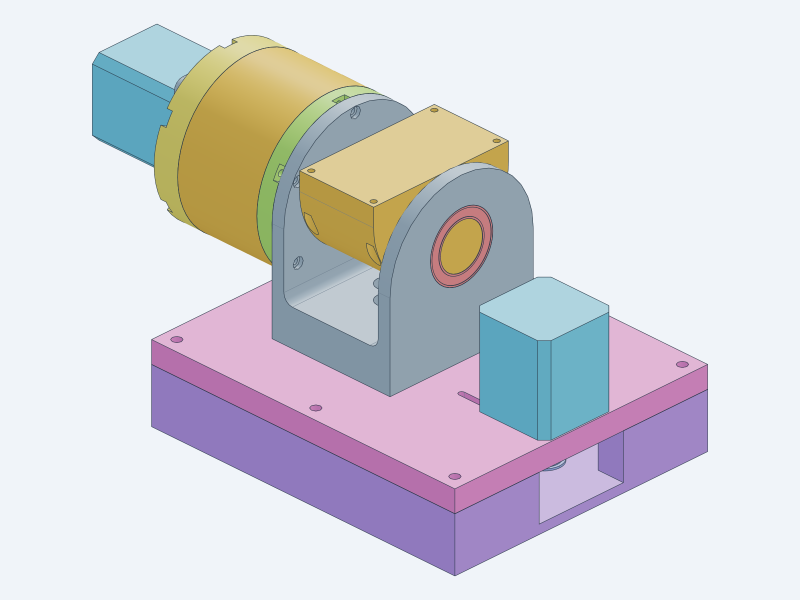
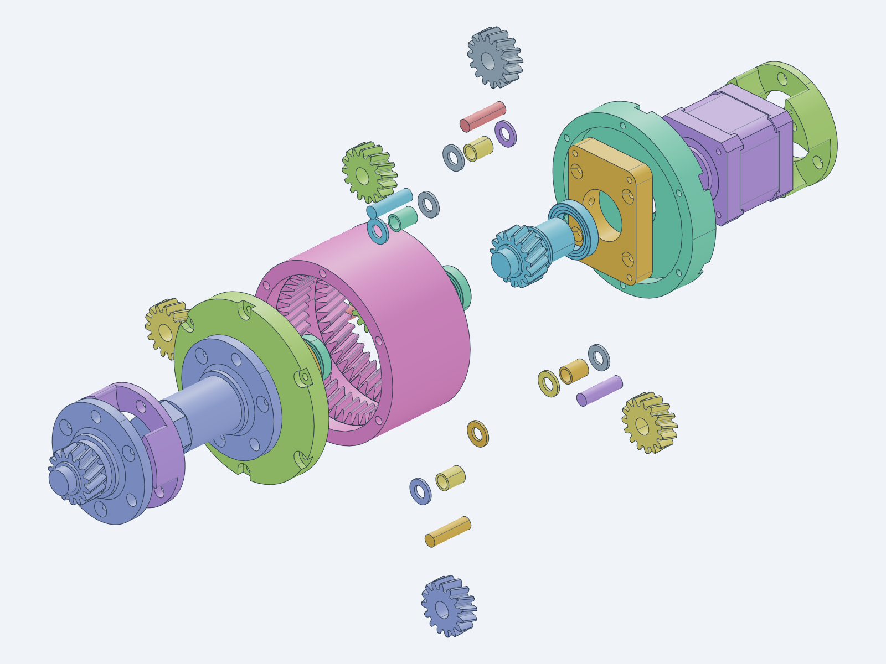
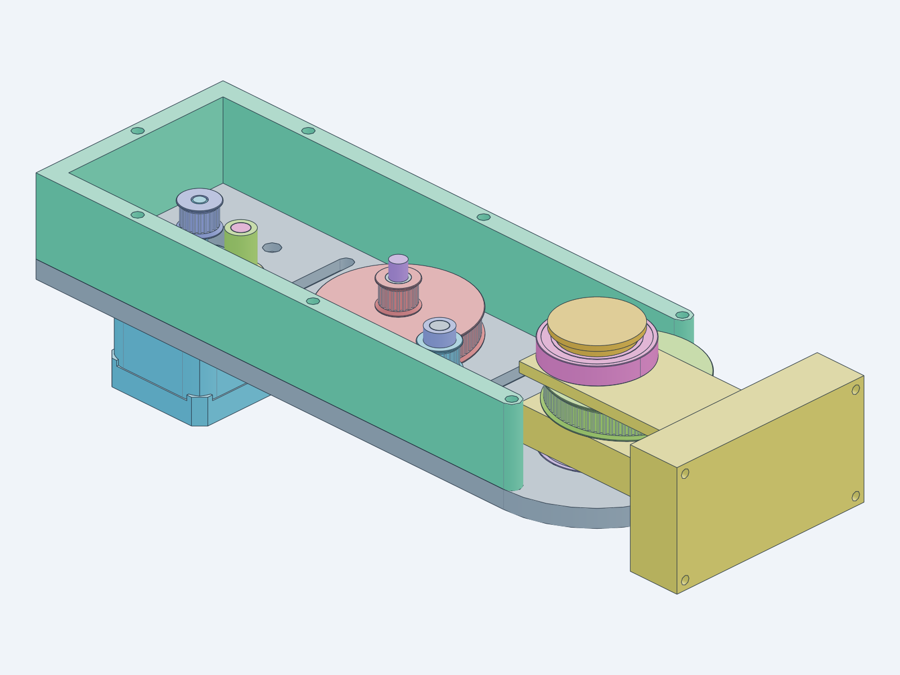

# Robotic Arm — Design Documentation (Fusion 360 baseline)

**14:125:444 Smart Prosthetics and Robotic Systems** — Dr. Adam Gormley

This document describes the reference robotic arm exactly as it exists in the three
Fusion 360 STEP exports. It is the specification for the Python
(text-to-cad / build123d) recreation.
**Nothing here is a redesign.** Flaws are recorded in
[Observed issues](#8-observed-issues-and-open-questions) and fixed later, one at a
time, after the scripted replica matches the original.

| Source file | Contents |
|---|---|
| `CAD/STEP/imported/fusion/Joint 1 and 2.step` | Base, joint 1 (waist), hinge, joint 2 (shoulder), embedded planetary gearbox |
| `CAD/STEP/imported/fusion/Planetary Gearbox - Two-stage 16to1 ratio.step` | The gearbox alone. It is geometrically identical to the copy embedded in `Joint 1 and 2.step` (every unique part matches by volume) |
| `CAD/STEP/imported/fusion/Belt Drive Arm.step` | One arm segment: belt drive and joint 3 output |

All dimensions are in mm and were measured from the STEP geometry with
`CAD/checks/inspect/dump_features.py`. The raw dumps are regenerated into
`CAD/tmp/inspect/`. Values marked *(inferred)* come from a geometry pattern,
not from a labelled feature.

---

## 1. System overview



The arm is a 4-DOF serial manipulator. Every joint is driven by a NEMA17 stepper
through a 8:1 or 16:1 reduction:

| Joint | Motion | Axis (in source frame) | Drive | Ratio |
|---|---|---|---|---|
| J1 | Waist yaw | Vertical, through (75, 75) in `Joint 1 and 2` | NEMA17 → GT2 20T → GT2 160T belt | **8:1** |
| J2 | Shoulder pitch | Horizontal ‖ X at y = 75, z = 70.5 (hinge) / 70.0 (gearbox), see [I‑1](#8-observed-issues-and-open-questions) | NEMA17 → two-stage planetary | **16:1** |
| J3 | Elbow pitch | ⟂ to the arm plates at (160, 40) in `Belt Drive Arm` | NEMA17 on segment 1 → two GT2 20T→80T belt stages | **16:1** |
| J4 | Wrist pitch | Same as J3, on segment 2 | Segment 2 is an identical copy of segment 1 | **16:1** |
| — | End effector | Bolts to segment 2's Output block (not modeled) | — | — |

The kinematic chain is: base → J1 hinge → J2 coupling shaft → segment 1 →
J3 output block → segment 2 → J4 output block → end effector. J2, J3 and J4 are
parallel, so the arm is a planar 3-link arm that yaws on J1.

**Link lengths** *(inferred from interface positions)*:
- J2 axis → segment‑1 mounting face: 30.0
- J2 → J3: 230.0
- J3 → J4: 274.2
- J4 → end-effector mounting face: 74.2

**Universal M3 link interface.** Every link-to-link joint uses the same bolted
pattern: 4 × M3 on a **73 × 37 mm** rectangle. It appears on:
- the top face of the coupling shaft (J2 output);
- the proximal end face of each arm segment (heat-set inserts in the Base and Top plates);
- the distal face of each Output block (J3/J4 output).

Keeping this pattern lets segments chain together, and it is the place an end
effector attaches.

**Fusion pose.** J1 = 0, and J2 holds the arm vertical (+Z), because the
coupling shaft's mounting face points up. The arm file is modelled lying flat,
in its own frame.

**Materials.** All printed parts are FDM PLA (last offering). Resin/SLA is a
candidate for gears and pulleys in the redesign.

---

## 2. Base and joint 1 (`Joint 1 and 2.step`)

### Load path and drive
1. **Motor.** The J1 NEMA17 (not modelled) sits on top of `Box top` with its
   shaft pointing down through a slot. A stock GT2 20T pulley on the shaft sits
   in the 30 mm cavity under the top plate.
2. **Belt and tension.** The belt runs to the `GT2-120` pulley, which actually
   has **160 teeth**. The motor slides 20 mm in the slot (center distance 65–85)
   to tension the belt.
3. **Axial clamp.** The pulley bolts to the bottom of `Hinge` with 4 × M5 at
   r = 10. This clamps a stack on the hinge's Ø35 shaft: hinge → upper thrust
   bearing 40×60×13 → `Box top` → lower thrust bearing → pulley. That stack
   carries the axial and tipping loads.
4. **Radial bearings.** A 6807 (35×47×7) seated in `Box top` and a 608 (8×22×7)
   on the pulley's Ø8 hub, seated in `Box bottom`.

### Parts

| Part (Fusion name) | Qty | Make | Envelope | Key features |
|---|---|---|---|---|
| `Box bottom v5` | 1 | Print | 180 × 150 × 30 | 15 mm walls, 5 mm floor, open pocket 150 × 120. 608 seat Ø22 on a Ø27 boss (z 5–12). 7 × M5 heat-set insert holes Ø6.4 × 10.5 deep (z 19.5–30) at x ∈ {7.5, 90, 172.5}, y ∈ {7.5, 142.5}, plus (7.5, 75). Side window in the +X wall at y 50–100 (wire/belt access). |
| `Box top v6` | 1 | Print | 180 × 150 × 12 | 7 × M5 clearance Ø5.3 matching the inserts. Ø60 × 5 recess on the underside (lower thrust bearing). Ø47 × 7 seat on top (6807). J1 motor slot: 25 wide, centers x = 140…160, y = 75. Two M3 slots (3.3 wide) at y = 59.5 / 90.5, x = 124.5…175.5 (31 mm NEMA17 pattern, sliding). |
| `Hinge v8` | 1 | Print | 70 × 85 × 121 | Vertical Ø35 shaft (33 long, through the 6807 and both thrust bearings). Ø61 × 10 pocket on the underside for the upper thrust bearing. 4 × M5 Ø5.3 at r = 10 with Ø12 counterbores. Two 7‑mm cheeks (x 0–7 and 63–70) with rounded R42.5 tops and Ø37 × 7 6805 seats on the J2 axis. Two Ø10 cross holes along Y (x = 12 and 58, z = 25; cable routing *(inferred)*). The left cheek has 5 × M3 (Ø3.3 + Ø6 counterbore) on r = 39.2 about J2 for the gearbox front cover; the 6th hole of the hexagonal pattern is missing. |
| `GT2-120 v4` (actually 160T) | 1 | Print | Ø103.35 × 22 | GT2 160T: OD 101.35, flange Ø103.35, tooth width 7 (z 0–7). Ø60 × 5 pocket (lower thrust bearing). Ø8 hub, 12 long, into the 608. 4 × Ø5.3 at r = 10. |
| `Coupling shaft v1` | 1 | Print | 50 × 80 × 56 | J2 output and segment‑1 mount. Block with an R40 rounded end. Hex socket **21.66 AF**, 29 deep, takes the gearbox output hex. Ø25 × 7 stub with Ø29 × 2 shoulder runs in the right-cheek 6805. Top face carries the **73 × 37 M3 link interface** (Ø3.3 + Ø6 counterbore). |
| Thrust bearing 40×60×13 | 2 | Buy | | |
| 6807 bearing 35×47×7 | 1 | Buy | | |
| 608 bearing 8×22×7 | 1 | Buy | | |
| 6805 bearing 25×37×7 | 2 | Buy | | In the hinge cheeks (J2) |
| NEMA17 + GT2 20T 5 mm bore (J1) | 1 | Buy | | **Not in the CAD**; to be added |
| GT2 closed belt, 6 mm (J1) | 1 | Buy | | Pitch length 340–373 over the slot range (356 at mid-slot); exact belt unknown |
| M5 bolts + inserts, M3 screws | — | Buy | | Lengths not recorded |

---

## 3. Planetary gearbox, joint 2



This is a **two-stage simple planetary with one shared ring.** Both stages use
**15° helical gears, transverse module 1.5, 20° pressure angle, no profile shift** (corrected in Session 3: the teeth twist uniformly, so they are helical, not spur):
- sun **15T** (OD 25.5, root 18.75);
- planets **15T**;
- ring **45T** internal (root Ø70.9).

Ring = sun + 2·planet (45 = 15 + 30). The planet center radius is 22.5.
Each stage has 3 planets, which assemble evenly because (15 + 45)/3 = 20 is an
integer. The ratio per stage is 1 + 45/15 = **4**, so the total is **16:1**.
Face width is 9 (planets). Hands: the ring and planets are right-hand (the tooth pattern turns CCW about the gearbox +Z axis toward the motor), the suns left-hand. All teeth are thinned by about 0.053 mm at the pitch circle (backlash allowance; the ring teeth are 3.91° wide against a nominal 4.0°). The ring's tip is Ø64.0 (addendum 1.167 m) and its root Ø70.9 (dedendum 1.133 m). The ring has two separate 12 mm toothed bands, one per stage, with a Ø72 relief groove between them; each band ends in a 45° chamfer. The suns and planets have root fillets of about 0.635 mm (0.42 m), and their tips are chamfered 0.4 mm at both faces. The ring's tooth tips are rounded about 0.385 mm. These radii were fitted to the Fusion section areas.

### Power path
1. **Input.** NEMA17 (5 mm shaft) → `Input shaft`, a stage‑1 sun with a Ø5.3
   bore and a Ø4 radial set-screw hole. It is supported by a 17×26×5 bearing in
   `Back cover` and a 12×21×5 bearing.
2. **Stage 1.** Three planets on 6 mm pins drive the stage‑1 carrier, which is
   two halves: `Carrier p1 - stage 1` + `Carrier p1 - stage 1 - Output`. The
   output half carries the **stage‑2 sun** (15T) and a Ø12 journal in a second
   12×21×5 bearing.
3. **Stage 2.** Three planets drive the stage‑2 carrier: `Carrier p1 - stage 2`
   + `Carrier p2 - stage 2 - Output`.
4. **Output.** The output carrier has a Ø25 × 30 shaft, running in the gearbox
   `Front cover` 6805 **and** the left hinge-cheek 6805. It ends in a
   **21.65 AF × 15 hex** that drives the `Coupling shaft`.

### Parts

| Part | Qty | Make | Envelope | Key features |
|---|---|---|---|---|
| `Ring gear` | 1 | Print | Ø85 × 47 | 45T internal, m1.5, runs both stages. Ø72 × 7.7 counterbore at the motor end. 6 × M3 heat-set insert holes Ø4.2 × 10 at r = 39.25 in **both** end faces (30° + 60k). |
| `Back cover v2` | 1 | Print | Ø85 × 14 | Ø72 pilot into the ring. Ø26 seat (17×26×5 bearing). 6 × M3 Ø3.3 on r = 39.25 with Ø7.5 × 3.2 pockets that run out radially to the rim as open U-slots. Ø72 × 7 recess for the stage‑1 carrier. 4 × M3 inserts Ø4.2 × 6 on a 33 × 48 rectangle for `NEMA17 mount`. |
| `NEMA17 mount` | 1 | Print | 41 × 56 × 10 | Motor 31 × 31 M3 pattern (Ø3). Ø24 boss bore. 4 × Ø3 on 33 × 48 to the back cover, with Ø10 head counterbores. Ø3.5 radial hole. |
| `Input shaft v5` | 1 | Print | Ø25.5 × 36.4 | 15T sun, 10 wide. Journals Ø11.94 (12×21×5 bearing) and Ø16.94 (17×26×5 bearing). Ø5.3 motor bore; Ø4 cross hole for a set screw. |
| `Carrier p1 - stage 1` / `Carrier p1 - stage 2` | 1 + 1 | Print | Ø56 × 19 | Same geometry, two occurrences. 3 × Ø6 pin holes at r = 22.5. 3 × Ø29.5 planet pockets. 3 × M3 insert Ø4.2 at r = 22, offset 60°. |
| `Carrier p1 - stage 1 - Output` | 1 | Print | Ø56 × 29 | Mating half plus the stage‑2 sun 15T. Ø12 journal. 3 × Ø6 pin holes. 3 × Ø2.8 pilot holes (M3). |
| `Carrier p2 - stage 2 - Output v5` | 1 | Print | Ø56 × 54 | Mating half plus the Ø25 × 30 output shaft (Ø29 shoulder) and the 21.65 AF hex, 15 long. |
| `Front cover v3` | 1 | Print | Ø85 × 11 | Ø37 × 7 6805 seat. Ø41 × 2 relief. 6 × M3 Ø3.3 on r = 39.25 with Ø7.5 × 3.2 pockets running out to the rim as open U-slots. Bolts to the ring gear and to the hinge left cheek. |
| `Planet gear` | 6 | Print | Ø25.5 × 9 | 15T, Ø8 bore for the bushing. |
| `Pin 6x11mm` | 6 | Buy | Ø6 × **22** | The name says 11 mm, but the part is 22 long |
| `Bushing 8mm` | 6 | Buy | 6 × 8 × 10 | Planet bushing (bronze/PTFE *(inferred)*) |
| `Washer 6mm` | 12 | Buy | 6.2 × 11.8 × 1.3 | Two per planet |
| Bearing 12×21×5 (6801) | 2 | Buy | | |
| Bearing 17×26×5 (6803) | 1 | Buy | | |
| Bearing 25×37×7 (6805) | 1 | Buy | | Front cover |
| NEMA17, 20 mm shaft | 1 | Buy | | |

---

## 4. Belt drive arm segment (joints 3 and 4)



### Structure
The segment is a 240 × 80 × 44 box with an R40 rounded distal end, built from
three printed plates fastened with M3 screws into heat-set inserts:
- `Base`, 7 thick, with bosses to 10.7;
- `Wall`, a 30-tall U-frame (7-wide side rails, 7-thick proximal end wall, open at the distal end);
- `Top`, 7 thick.

The proximal end faces of Base and Top carry Ø4.2 insert holes (x‑axis, at
y = 3.5 / 76.5 and z = 3.5 / 40.5), which form the 73 × 37 link interface.

### Drive (16:1)
1. NEMA17 under `Base` at (−10, 40), pilot through Ø30, M3 on the 31 mm pattern.
2. GT2 **20T** (COTS, 5 mm bore) drives `Dual GT2 pulley` at (75, 40): **80T**
   driven, then **20T** driver. It turns on two 6×8×10 bushings on a 6×30 dowel pin.
3. The dual pulley drives `GT2-80 output` (80T) at (160, 40), which is keyed by
   a **21.66 AF hex bore** onto two `Pin` hex shafts.
4. Each stage has a center distance of 85, which gives a 274.3 mm open-belt
   pitch length. A 280 mm (140T) loop *(inferred)* would be taken up by the idlers.
5. Each belt has a `GT2-20 idler` on a 6×30 dowel pin with 5 / 15 mm spacers.
   The pins sit in **slots in the Top plate (y 20 ↔ 65)** so the idler slides to
   tension the belt. The Base has matching Ø10 / Ø5.3 positions at y = 20 and y = 65.

### J3 output
1. Two `Pin` parts run in 6805 bearings, one seated in `Base` and one in `Top`
   (Ø37 seats at (160, 40)). Each Pin is a Ø30 × 2 flange, a Ø25 × 10 journal,
   and a 21.48 AF × 15 hex.
2. The Pins enter the GT2‑80 output from above and below. `Output block` also
   intersects both Pins (I‑6). The block has hex-oriented faces, so it is
   probably keyed to the Pins as well; confirm this when recreating it.
3. `Output block` (80 × 44 × 90) slides into the open distal end of the U-wall
   and projects 34 mm beyond the R40 end. Its distal face carries the 73 × 37 M3
   link interface (Ø3.3 + Ø6 counterbore) for the next segment or the end
   effector. It also has two Ø10 cross holes (cable routing *(inferred)*).

### Parts

| Part | Qty | Make | Envelope | Key features |
|---|---|---|---|---|
| `Base` | 1 | Print | 240 × 80 × 10.7 | NEMA17 pilot Ø30 plus 4 × M3 (Ø3.3, Ø6 counterbore). Ø37 6805 seat. Dowel holes Ø6.1. Idler positions Ø10 × 3 / Ø5.3. Ø6 counterbore + Ø3.3 for M3 to the Wall. Proximal Ø4.2 inserts. |
| `Wall` | 1 | Print | 203.5 × 80 × 30 | U-frame; 7 × Ø4.2 vertical insert holes through the full 30 (used from both faces). Ø7 at x = 160. |
| `Top` | 1 | Print | 240 × 80 × 8.7 | Mirror of the Base pattern. Idler slots (Ø8 / Ø5.3, y 20 ↔ 65). Ø37 6805 seat. Ø6.1 × 1.7 boss socket for the dual-pulley dowel. Proximal Ø4.2 inserts. |
| `Dual GT2 pulley` | 1 | Print | Ø52.4 × 20 | GT2 80T (z −10…−3) + 20T (z 0…7) on one body, Ø8 bore |
| `GT2-80 output` | 1 | Print | Ø52.4 × 10 | GT2 80T, 21.66 AF hex bore |
| `Pin` | 2 | Print | Ø30 × 27 | Flange / journal / hex, as above |
| `Output block` | 1 | Print | 80 × 44 × 90 | J3 output bracket and link interface |
| `Spacer 5mm` / `Spacer 15mm` | 2 / 2 | Print | Ø10 / Ø6.3 | Idler height spacers |
| `GT2-20` | 1 | Buy | Ø14.2 × 10 | 20T, 5 mm bore (motor) |
| `GT2-20 idler` | 2 | Buy | Ø14.2 × 10 | 20T toothed idler, **5 mm bore in the CAD**; the part actually used is unknown, see [I‑5](#8-observed-issues-and-open-questions) |
| `Bushing 6x8x10mm` | 2 | Buy | | Dual pulley on the dowel |
| `dowel pin 6x30mm` | 3 | Buy | | Dual-pulley axle and 2 idler axles |
| 6805 bearing 25×37×7 | 2 | Buy | | J3 |
| NEMA17, 20 mm shaft | 1 | Buy | | |
| GT2 closed belt, 6 mm | 2 | Buy | | ~280 mm *(inferred)* |

Segment 2 (J4) is an identical copy of this segment.

---

## 5. Interface table (locked during recreation)

| ID | Interface | Parts | Locked dimensions |
|---|---|---|---|
| IF‑1 | J1 axis | Box top, Hinge, GT2‑160, bearings | Axis (75, 75); 6807 seat Ø47 × 7; thrust recesses Ø60/Ø61; Ø35 shaft; 608 seat Ø22 |
| IF‑2 | Base box fasteners | Box top ↔ Box bottom | 7 × M5 at the listed positions |
| IF‑3 | J1 motor mount | Box top | Slot 25 wide, x 140–160; M3 slots at y = 59.5 / 90.5 |
| IF‑4 | J2 axis | Hinge, gearbox, coupling | Hinge 6805 seats Ø37; **axis height: see I‑1** |
| IF‑5 | Gearbox ↔ hinge | Front cover ↔ hinge left cheek | 6 × M3 on r = 39.25 (5 present in the hinge) |
| IF‑6 | Gearbox internal | Ring, covers, carriers | Transverse m1.5, 20°, 15° helix, 15/15/45T, planet radius 22.5, face width 9; ring Ø85 |
| IF‑7 | Gearbox output hex | Carrier p2 output ↔ Coupling shaft | 21.65 AF hex in a 21.66 AF socket; Ø25 shaft |
| IF‑8 | **Link interface** | Coupling shaft, arm proximal end, Output block | 4 × M3 on 73 × 37, arm thickness 44, width 80 |
| IF‑9 | NEMA17 | All three motors | 31 × 31 M3, Ø22 pilot, 5 mm shaft |
| IF‑10 | J3 hex | Pin ↔ GT2‑80 output ↔ Output block | 21.48 / 21.66 AF; Ø25 journal; 6805 seats at (160, 40) |
| IF‑11 | GT2 geometry | All pulleys | 2 mm pitch; 20T / 80T / 160T; 6 mm belt; 7 mm tooth width |

---

## 6. Fastener and print conventions (as found)

| Hole | Meaning *(inferred)* |
|---|---|
| Ø3.3 | M3 clearance |
| Ø6 counterbore | M3 socket-head clearance |
| Ø4.2 | M3 heat-set insert |
| Ø2.8 | M3 self-tap pilot |
| Ø5.3 | M5 clearance |
| Ø6.4 | M5 heat-set insert |
| Ø6.1 | 6 mm dowel slip fit |
| Ø7.5 × 3.2 pocket, open radial slot | nut / screw-head pocket on the gearbox covers |

Purchased-part models and their sources (step.parts vendor files or parametric
stand-ins) are listed in [`CAD/src/README.md`](../src/README.md).

Bearing seats are modelled at the nominal bearing OD, with no print allowance.
The recreation should keep the nominal values and add the allowance through a
named tolerance parameter (`lib/tolerances.py`, Session 2).

---

## 7. Coordinate frames for the rewrite

During the **replica phase**, every part keeps its Fusion local frame, so that
`checks/compare_to_fusion.py` can compare like with like. Each subassembly
keeps its Fusion frame:
- `Joint 1 and 2`: origin at the box corner; top of `Box bottom` at z = 0; J1 at (75, 75).
- `Belt Drive Arm`: origin at the proximal end + 40, on the Base underside; plates in XY; J3 at (160, 40).

The **full-arm assembly** (Session 6) uses a robot frame:
- origin on the J1 axis at the top surface of `Box top`;
- +Z up; +X along the arm at J1 = 0 *(direction to confirm in Session 6)*;
- joint zero is the Fusion pose (arm vertical).

---

## 8. Observed issues and open questions

These are logged, **not fixed**: the replica reproduces them. Field reports from
the last offering are marked 🔧.

| ID | Severity | Issue | Evidence |
|---|---|---|---|
| I‑1 | **High** 🔧 | **J2 is misaligned and over-constrained.** The gearbox axis is at z = 70.0, but the hinge 6805 seats and the coupling shaft are at z = 70.5 (0.5 mm offset). The output shaft runs in three bearings (front cover, left cheek, right cheek via the coupling), so any offset binds. Students reported J2 stiffness and binding. | `checks/inspect/interference.py`: Carrier p2 output × left 6805 = 86 mm³; axis survey |
| I‑2 | Medium | The output hex (21.65 AF) and the coupling socket (21.66 AF) overlap by 2803 mm³ in the model: the hex is rotated 43.5°, not a multiple of 60°, and is offset by I‑1. The fit itself is only 0.01 mm across flats, which leaves no print allowance. | interference |
| I‑3 | Medium 🔧 | **Gear wear and backlash.** m1.5 (transverse) 15° helical PLA gears with 9 mm face width at 16:1 near the output. The helix adds an axial thrust that the carriers and washers must react. There is no clearance or backlash allowance; the planets mesh at nominal center distance. | gear data |
| I‑4 | Medium 🔧 | **Belt tensioning.** The arm idlers slide in slots with no positive lock, and J1 relies on a friction-locked motor slot. | geometry |
| I‑5 | Medium | The `GT2-20 idler` has a 5 mm bore but sits on a 6 mm dowel pin (86 mm³ overlap). The part actually used is unknown. | interference |
| I‑6 | Low | The `Pin` hex in `GT2-80 output` overlaps by 98 and 1812 mm³. Pin 2 is rotated 137.2°, so its hex is misaligned. The Pins also overlap `Output block` by 374 and 83 mm³, so check the hex pocket depth. | interference |
| I‑7 | Low | Planets overlap the ring and sun by 25–65 mm³: they sit at the Fusion tooth phases, which don't mesh. This is cosmetic. The recreated gearbox reproduces it: sun × planet 65.0 mm³ (Fusion 65.0); ring × planet 54 / 52 mm³ (Fusion 36 / 26, from the remaining ring tip-shape difference). | interference |
| I‑8 | Low | The J1 motor, J1 20T pulley, all belts, all fasteners, segment 2, J4 and the end effector are missing from the CAD. | tree |
| I‑9 | Low | Naming errors: `GT2-120` is 160T; `Pin 6x11mm` is 22 long; `Component1/2/7` wrappers; an empty `Component2`; a `test` product in the arm. | tree |
| I‑10 | Low | The hinge left cheek has 5 of the 6 front-cover bolt holes. | features |
| I‑11 | Info | All bearing seats are at the nominal OD; PLA needs a press-fit allowance. | features |
| I‑12 | Info | The thrust bearings (40 ID) ride on a Ø35 shaft, leaving 2.5 mm radial slop; they are centered only by the Ø60/61 recesses. | features |
| I‑13 | Info | The hinge has two R42.5 boss profiles at different heights (z = 62.5 and 70.5). Check whether the offset is intentional. | features |

### Open questions (deferred)
- Q1: The belt lengths actually bought, for J1 and the arm stages.
- Q2: Where the nuts are for the hinge → GT2‑160 M5 bolts (both parts have only clearance holes).
- Q3: The idler part actually used (I‑5).
- Q4: The Ø7.5 cover pockets are round counterbores that run out radially as open U-slots, not hex traps (resolved, Session 3). What sits in them, an M3 nut or a screw head, is still unknown.

---

## 9. Regenerating the measurements

```bash
cd CAD
CADPY="uvx --no-config --managed-python --python 3.13 --from cadgen==0.7.26 python"
F=STEP/imported/fusion
$CADPY checks/inspect/dump_features.py "$F/Joint 1 and 2.step" "$F/Belt Drive Arm.step" \
    "$F/Planetary Gearbox - Two-stage 16to1 ratio.step"   # -> tmp/inspect/*.txt
$CADPY checks/inspect/interference.py "$F/Joint 1 and 2.step" "$F/Belt Drive Arm.step"
```
